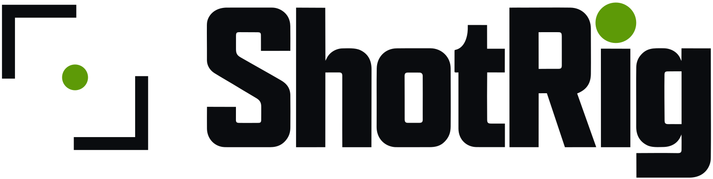
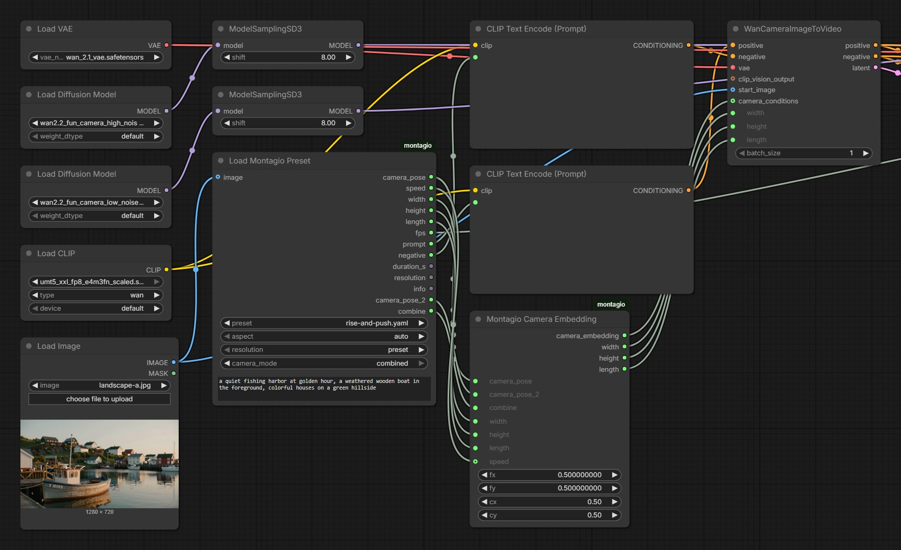
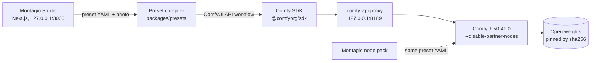

<h1>
  <picture>
    <source media="(prefers-color-scheme: dark)" srcset="docs/brand/montagio-logo.svg">
    
  </picture>
</h1>

[](docs/BUILD_NOTES.md#on-the-comfy-developer-platform)
[](#proof-measured)
[](#proof-measured)
[](comfy-nodes/README.md)
[](#credits-and-licenses)

**Click like a one-click video app. Open the hood like ComfyUI.**

Montagio is an open-source AI video studio in the spirit of Higgsfield: drop a photo, pick a camera move, an effect or a hook, and get a clip. It runs on your own GPU, for free, with no account, no credits and no paid API, and it ships only open weights licensed Apache-2.0 or MIT. It is built with the [Comfy SDK](https://github.com/Comfy-Org/comfy-typescript-sdk), which drives a local [ComfyUI](https://github.com/Comfy-Org/ComfyUI) v0.41.0 through [comfy-api-proxy](https://github.com/Comfy-Org/comfy-api-proxy).

[Try it](#try-it) · [What you can make](#what-you-can-make) · [ComfyUI node pack](#the-montagio-node-pack-for-comfyui) · [Proof, measured](#proof-measured) · [Install](#install) · [Roadmap](#roadmap) · [Build notes](docs/BUILD_NOTES.md) · [Licenses](#credits-and-licenses)

## Try it

<!-- TODO before submission: replace the two placeholders below with the showcase's *.hf.space URL and the demo video URL. -->

| | |
|---|---|
| **Showcase** (in your browser, no install) | _TODO: showcase URL_ |
| **Demo video** | _TODO: video URL_ |
| **Your own GPU** | one command, see [Install](#install) |
| **ComfyUI** | the [node pack](comfy-nodes/README.md) and the [workflows](comfy-hub/README.md), ready to load |

The showcase is a static copy of the real Studio. Pick a sample photo and a camera preset to play a clip pre-rendered with Montagio on open weights, assemble a 2–3 shot film in your browser (FFmpeg compiled to WebAssembly), remix a preset and check it, download its ComfyUI workflow. It renders nothing on a GPU, costs nothing to host and collects nothing. How it is built and published: [docs/VITRINE.md](docs/VITRINE.md) (in French).

### From an MCP client

Once Montagio runs on your machine, any MCP client (a desktop assistant, an IDE, an agent framework) can drive it through a local MCP server: "animate this photo with Crash Push", "make the dog squish", "generate an image, then apply Explode". The server calls the app's own HTTP API, renders nothing itself and keeps the Studio's consent rule. Setup, the client configuration and the 15 tools: [packages/mcp](packages/mcp/README.md).

## Why Montagio

- **Free and local.** ComfyUI, the proxy and the app listen on `127.0.0.1` only. There is no key, no paid API and no credit to buy, and your photos and clips never leave your machine.
- **Open weights only.** Every weight Montagio can download is licensed Apache-2.0 or MIT, read at its source repository and pinned by sha256. There is no partner node, no closed API and no proprietary connector. A CI check, `check-open-stack`, proves it on every commit.
- **Presets are files, not a lock-in.** Every camera move, effect and hook is a YAML file under CC-BY-4.0 that compiles into a ComfyUI workflow. Remix one in the Studio, download the exact workflow behind any clip, or load the same preset in a ComfyUI graph with the [Montagio node pack](comfy-nodes/README.md).
- **Proven on a real GPU.** Every model below rendered on a 24 GB GPU, with its time measured, and its peak VRAM for all but the hook transition.

## What you can make

The app opens on **Explore**, the clips it makes and a door to every tool. The Studio has one tab per kind of creation: Effects, Camera, Film, Avatar, Motion. Then come the **Characters**, the **Ad studio**, the **Voice change** and the History.

| Feature | What it does | Model (license) |
|---|---|---|
| **Camera** | A photo and one of 11 camera presets give a 5 s clip. You describe what the photo shows, so the model follows the photo instead of inventing it. | Wan 2.2 Fun Camera 14B (Apache-2.0); a **Fast** mode on Wan 2.2 TI2V 5B (Apache-2.0) |
| **Film** | Two or three camera moves in a row: each shot starts on the last frame of the previous one. The film keeps the photo's shape (16:9, 9:16 or 1:1), takes a music track, and always comes with a 9:16 cut for vertical feeds. | the same |
| **Remix** | Edit a preset's YAML in the Studio, check it line by line, render it, download it. "Open in ComfyUI" downloads the exact workflow of any clip. | — |
| **Start photo** | No photo? **Write one**, and set the shot like a cinema studio: camera, lens, film, light and palette chips add fixed phrases to the text (no brand names). Or **draw it**: a sketch and a few words, and the photo edit turns the drawing into a photo, keeping its layout and colours. | Z-Image-Turbo, Qwen-Image-Edit-2511 (Apache-2.0) |
| **Characters** | Make a fictional character once from a type and a few words, save it, then its **photodump**: the same character in the scenes you pick. Any picture opens Camera, Effects, Avatar or Motion with it as the start photo, its description filled in. A character is never a photo of someone: only pictures made from a text here, and edits of them, qualify. | Z-Image-Turbo and Qwen-Image-Edit-2511 (Apache-2.0) |
| **Ad studio** | A product photo, a character if you like (or one of yours), a style (Studio, Lifestyle, Bold), an effect and a tagline give a 9:16 ad with music: the edit stages the scene with room for the tagline, the effect animates it, ACE-Step writes the music. | Qwen-Image-Edit-2511, Wan 2.1 I2V and an effect LoRA (Apache-2.0), ACE-Step 1.5 (MIT) |
| **Voice change** | The speech of a clip, sent here or made by the avatar, said again in the voice of a sample its speaker agreed to lend; the words, the rhythm and the picture stay. | Chatterbox VC (MIT) |
| **History** | Every photo, clip and film, with download and reuse. | — |

The 11 camera presets are Slow Push, Crash Push, Pull Back Reveal, Pan Left, Pan Right and Crane Up, plus five presets with two moves. Rise & Push, Drift Left Push and Pull Back & Tilt Up run both moves at once; Push & Settle and Breathing run one after the other. The core ComfyUI node takes a single move, so the two-move presets go through a node of the Montagio pack, Montagio Camera Embedding.

### Seven extensions, validated on a 24 GB GPU

| Extension | In the Studio | Model (license) |
|---|---|---|
| **Photo edit** | "Edit" on the start photo: an instruction in plain words, three looks (inflated, figurine, angle of view), ready-made **relights** (golden hour, neon night, studio…), and **inpaint**: paint what changes, the rest of the photo stays pixel for pixel | Qwen-Image-Edit-2511 with a 4-step Lightning LoRA (Apache-2.0) |
| **Six one-photo effects** | the Effects wall: Squish, Cake-ify, Explode, Snap Zoom, Frozen Moment, Full Circle; with **Character · Location · Product**, two or three photos are first composed into one scene, then the effect plays on it | Wan 2.1 I2V 480p (Apache-2.0) with effect LoRAs by Remade-AI (Apache-2.0) |
| **Hooks** | a keyframe transition: the edit makes the end frame, the video model animates the way there. Wardrobe Swap, which takes an outfit photo too, and Ignite are validated. | Wan 2.2 FLF2V (Apache-2.0) |
| **Talking avatar** | the Avatar tab: a photo and a text (English or French) give a talking clip, in the built-in voice or in a **voice sample** given with its speaker's consent | Wan 2.2 S2V (Apache-2.0), voice by Chatterbox Multilingual (MIT) |
| **Music** | "Add music" under a finished film, mixed into the film and its 9:16 cut | ACE-Step 1.5 (MIT) |
| **HD** | "HD 1080p" under a finished clip, with **smooth motion** ticked by default: RIFE puts a frame between each two, so a 16 fps clip comes out at 32 fps; "HD 2560 px" on a photo of the atelier or of a character | SeedVR2 3B (Apache-2.0), RIFE 4.26 (MIT) |
| **Motion transfer** | the Motion tab: the character of a photo moves like a reference video of up to 5 s | Wan2.2-Animate-2, distilled (Apache-2.0) |

The seven were validated in GPU session S2 on 2026-10-21. Relight, inpaint, the HD photo, the photodump, the voice sample, the composition, the ad, the drawing and the voice change came after, on these same models, and each was rendered on the L4 on 2026-10-22; smooth motion on 2026-10-24. An extension appears in the Studio only when a GPU session has validated it and its weights are installed. The order of priority, the cut rule and the reasoning behind every model choice are in [docs/EXTENSIONS_ANALYSE.md](docs/EXTENSIONS_ANALYSE.md) (in French).

## The Montagio node pack for ComfyUI

> [!NOTE]
> **Two camera moves in one Wan 2.2 Fun Camera clip, and camera presets as files.** The core `WanCameraEmbedding` node takes one move. **Montagio Camera Embedding** takes two, at once or one after the other, as a drop-in replacement. **Load Montagio Preset** turns a preset file into the moves, the size, the frame count, the fps and the prompts of the graph, so a preset menu replaces the rewiring, in a graph or in App Mode. The pack ships its example workflow (ComfyUI lists it under Templates), the 11 presets, and tests that compare its values with the app's. It is GPL-3.0, prepared for the Comfy Registry.
>
> [Read about the pack](comfy-nodes/README.md) · [the example workflow](comfy-nodes/example_workflows/montagio-camera-presets.json)



The other pipelines, as plain ComfyUI graphs with their build notes (models and where they go, node map, measures, limits): [comfy-hub/](comfy-hub/README.md). One-photo effect, keyframe hook, talking avatar, motion transfer, HD with smooth motion and film music; all core nodes.

## Proof, measured

GPU session S2 ran on 2026-10-21 on an NVIDIA L4 with 24 GB of VRAM, the memory of the RTX 4090 that Montagio targets. It was the first time anything rendered: before it, every workflow had only been checked by a real ComfyUI with empty model files. The full report, with every verdict: [docs/S2_RESULTATS.md](docs/S2_RESULTATS.md) (in French).

- **687 node classes loaded, 0 partner nodes.** ComfyUI always starts with `--disable-partner-nodes`, and the installer stops everything if `/object_info` shows a partner node.
- **Every weight checked against its sha256.** The lock holds 48 entries, 35 under Apache-2.0 and 13 under MIT ([registry/models.lock.yaml](registry/models.lock.yaml)); S2 downloaded and checked the 45 it held then, with no failure, and the three added since (RIFE 4.26 and two Chatterbox files) go through the same downloader, which refuses a file whose sha256 or size differs.
- **Licenses read at the source.** The license that counts is the one of the source repository, not the one a mirror declares. [allowed-sources.yaml](tools/check-open-stack/allowed-sources.yaml) lists every repository a weight may come from, with the revision read, and refuses the repositories that official templates use but that carry non-commercial or territory-restricted files.
- **Cheap to prove.** S2, the first GPU session, cost $12.94 of rented compute; each validation run since, on 2026-10-22 and 2026-10-24, cost under $0.20. A 5 s camera clip costs about $0.35–0.40 on a rented L4, an effect about $0.05. On your own GPU it costs electricity.

Measured on the L4 (an RTX 4090 is about twice as fast, going by the official templates' timings):

| Job | Time on the L4 | Peak VRAM |
|---|---|---|
| Camera preset, 5 s at 480p (Fun Camera 14B, 20 steps) | 1,110–1,170 s | 18–21 GB |
| Fast mode, 5 s at 480p (Wan 2.2 5B) | 190 s, cold | 21.2 GB |
| Text to image (Z-Image-Turbo) | 9–10 s, warm | 20–22 GB |
| Photo edit, 4 steps (Qwen-Image-Edit-2511) | 20–25 s, warm | 21.5–22.6 GB |
| One-photo effect, 4 steps (Wan 2.1 I2V and LoRA) | 156 s, warm | 21–22.6 GB |
| Composition from three photos, then the effect | 46 s, then 182 s | 22.4 GB |
| Hook transition, 4 steps (Wan 2.2 FLF2V), after the edit | 134–157 s | — |
| Talking avatar, 3–4 s of speech (Wan 2.2 S2V), after the voice | 127–145 s | 21.7 GB |
| Voice (Chatterbox) | 2.5–5 s, warm | 3.3 GB |
| Voice change (Chatterbox VC), a 4 s clip | 23.6 s, cold | 4.3 GB |
| Music, 60 s (ACE-Step 1.5) | 9.5 s, warm | 10–14.6 GB |
| HD upscale, 81 frames to 1080p (SeedVR2 3B) | 428 s | 18.4 GB |
| HD with smooth motion, 81 frames at 16 fps to 161 at 32 fps in 1080p (SeedVR2 3B, then RIFE 4.26) | 410 s, of which RIFE 4.8 s | 8.6 GB |
| HD photo, to 1440×2560 (SeedVR2 3B) | 14 s | 19.9 GB |
| Motion transfer, 5 s (Animate-2 distilled) | 391–415 s | 20.1–22.2 GB |

Every measure, with its date, cold and warm, and the ad, drawing, character and relight runs: [docs/BUILD_NOTES.md](docs/BUILD_NOTES.md#measured-on-a-gpu).

What the session taught, and changed:

- **The photo's description is required.** Without a text saying what the photo shows, Fun Camera invents and the clip turns ghostly: the diagnosis changed one variable per clip, and the description alone fixed it. The Studio now asks for it, and fills it in whenever the photo's text is known.
- **HD goes through the upscale.** 480p followed by SeedVR2 gives 1080p about three times faster than rendering 720p natively.
- **Honest limits.** Fun Camera handles push-ins, pull-backs and side moves well, and vertical moves and rotation poorly: Tilt Up became Crane Up, Tilt Down and a Dutch angle were dropped. Two hooks stay hidden: Iris Dive until it gets an intermediate keyframe, Figurine because its change is barely visible. The avatar's built-in voice is male, whatever the face: a consented voice sample replaces it. Motion transfer needs a photo framed like the reference video.

## How it works



- A preset is a YAML file. The compiler fills a ComfyUI workflow converted from the official [Comfy-Org workflow templates](https://github.com/Comfy-Org/workflow_templates); every change from a template is listed in [workflows/README.md](workflows/README.md).
- The app talks to ComfyUI only through the Comfy SDK and comfy-api-proxy: `workflows.fromJson`, `assets.fromFile`, `submit`, then `jobs.get` until the output is ready. The base URL is explicit and local, the SDK's `fetch` refuses any other origin, and no Comfy API key ever reaches it.
- Everything is core ComfyUI nodes, apart from the Montagio node pack and one pinned, patched third-party node for the voice.

The path of a request, the workflows behind each feature, every measure and the design choices: [docs/BUILD_NOTES.md](docs/BUILD_NOTES.md).

| Folder | What |
|---|---|
| [apps/web](apps/web) | the Studio and its server routes |
| [packages](packages) | the preset compiler, the model registry, the ComfyUI adapter, the film assembly (FFmpeg), the showcase builder, the [MCP server](packages/mcp/README.md) |
| [presets](presets) | the camera presets, [effects](presets/effects) and [hooks](presets/transitions), in YAML |
| [registry](registry) | the models, the extensions and the weights lock |
| [workflows](workflows) | the ComfyUI workflows, in API format |
| [comfy-nodes](comfy-nodes/README.md) | the Montagio node pack for ComfyUI |
| [comfy-hub](comfy-hub/README.md) | the main pipelines as ComfyUI graphs, with their build notes |
| [infra](infra) | the local installer, and the GPU-session tooling ([Modal](infra/modal/README.md), Runpod) |
| [tools/check-open-stack](tools/check-open-stack) | the open-stack check |

## Install

One command checks your machine, installs ComfyUI, comfy-api-proxy, the node pack, the weights and the app, then opens the Studio at `http://127.0.0.1:3000`.

Linux:

```bash
./montagio.sh install
```

Windows (PowerShell):

```powershell
powershell -ExecutionPolicy Bypass -File .\montagio.ps1 install
```

| You need | |
|---|---|
| GPU | NVIDIA with 24 GB of VRAM (RTX 3090, RTX 4090, L4, A10, A5000…) and driver R580 or newer |
| System | Windows 10 or 11 (x64), or Linux x64 |
| RAM | 32 GB or more recommended |
| Disk | about 110 GB free by default |
| Tools | Node.js 22.18+, Python 3.10–3.13, git, FFmpeg; the installer prints the command that installs whatever is missing |

What gets downloaded:

| Option | Weights | Disk |
|---|---|---|
| default | the camera presets and the effects pack (84 GiB) | about 110 GB |
| `--extensions all` | every extension, the avatar aside (see below) | about 200 GB |
| `--extensions none` | the camera presets alone | about 90 GB |
| `--app-only` | none: the app alone, in demo mode or rendering on a remote GPU with `--proxy-url` | — |

Add `--dry-run` to see every step without changing anything. A stopped download resumes when you run the same command again. The local installer leaves the talking avatar and the voice change out for now: their voice runs on a custom node that only the GPU-session tooling installs.

Everything else, from everyday commands to troubleshooting and uninstalling: [docs/INSTALL.md](docs/INSTALL.md).

## Roadmap

The next steps follow the same rule as everything above: an open model enters the weight lock only once its license, read at the source, is Apache-2.0 or MIT with no added condition, and a feature reaches the Studio only once a GPU session has validated it. They are sorted by how much they take.

**Within reach: the models are already here, or the work is outside the models.**

| Area | Next step |
|---|---|
| Sharing | a Share button: the 9:16 cut ready for vertical feeds, a caption to copy, an optional "Made with Montagio" end card, the "AI-generated" mention kept |
| Photo description | fill in "What the photo shows" automatically with a small open captioning model (Florence-2 is the candidate, its weights and node to be read at the source), the field staying editable |
| Hooks | Iris Dive with an intermediate keyframe, a stronger Figurine, Earth Zoom Out in five keyframes, all on the edit and FLF2V already in the lock |
| Camera moves | orbits and bullet time from keyframes: Edit-2511 viewpoints, then Wan 2.2 FLF2V |
| Photo edit | more looks and finer relights as Apache-2.0 LoRAs on Edit-2511 |
| Music | songs with lyrics on ACE-Step 1.5 |
| Install | the avatar and the voice change in the local installer; a container image |
| ComfyUI | the node pack published on the Comfy Registry, the workflows on the Comfy Hub (both prepared) |
| Provenance | C2PA manifests on every output (c2pa-python, Apache-2.0) |

**One new open model to validate on 24 GB.**

| Area | Next step, with the open model planned |
|---|---|
| Restyle | restyle or swap what a clip shows while its motion stays: VACE 14B (Apache-2.0), validated on a GPU on 2026-10-24, not merged yet |
| Image | posters with legible text: Qwen-Image-2512 (Apache-2.0) |
| Voice | a more natural voice in more languages: Qwen3-TTS (Apache-2.0) |
| Talking avatar | longer takes: LongCat-Video-Avatar (MIT) |
| Consistent character in video | Phantom (Apache-2.0) |
| Finishing | background removal: BiRefNet, pending a license check at the source |
| Director | an open LLM of the Qwen3 family (Apache-2.0) that turns a short script into a shot list of presets |
| Motion transfer | dance driven by the film's music: Wan-Dancer, once its license is read |

**Larger: a new model family, long video or training.**

| Area | Next step, with the open model planned |
|---|---|
| Long video | minute-long clips: LongCat-Video (MIT), MAGI-1 (Apache-2.0) |
| Character | a character LoRA trained in the app, with recorded consent (Z-Image or Qwen-Image) |
| New effects | an Apache-2.0 Earth Zoom Out LoRA trained on Montagio's own keyframe chains; a camera LoRA trained on synthetic renders |
| Sound | a video model with native sound, and foley, under a truly free license: none passes the rule yet |
| Running elsewhere | one adapter that runs these same open weights on any rented GPU |

Never on the roadmap:
- connectors to closed video APIs (Seedance, Kling, Veo…), partner nodes, or models reached through the Comfy Router;
- weights under a non-commercial, revenue-threshold or territory-restricted license (LTX-2.5, FLUX.3 klein, MiniMax H3, HunyuanVideo…);
- face swap built on InsightFace, selfies with celebrities, and anything not safe for work.

## Responsible use

Do not make videos of real people without their consent, nothing illegal and nothing not safe for work.

- Before an edit, an effect, a hook or an avatar on an uploaded photo, the Studio asks you to confirm that you are the person in it or have their consent. Motion transfer asks you to confirm that you hold the rights on the photo and the video. A voice sample, for the avatar or the voice change, needs its speaker's agreement.
- A [list of well-known names](registry/blocked-names.txt) is refused in text-to-image prompts, edit instructions, effect subjects, avatar texts and motion-transfer descriptions. It is a good-faith guardrail, not a complete filter.
- Every clip, image and sound is tagged "AI-generated" in its metadata, and the Studio shows the mention under each result with the model and its license.
- No content filter is imposed on your own machine: what you render locally is your responsibility.

Security issues: [SECURITY.md](SECURITY.md).

## Credits and licenses

| Montagio part | License |
|---|---|
| App and server ([apps/](apps), root) | [AGPL-3.0-only](LICENSE) |
| Libraries ([packages/](packages), [tools/](tools)) | Apache-2.0 |
| GPU-session tooling and installer ([infra/](infra)) | Apache-2.0 |
| ComfyUI node pack ([comfy-nodes/](comfy-nodes)) | [GPL-3.0-only](comfy-nodes/LICENSE) |
| Preset library ([presets/](presets)) | [CC-BY-4.0](presets/LICENSE) |

**Model weights** keep their own licenses, all Apache-2.0 or MIT, and are downloaded from their repositories, never bundled. Most files come from Comfy-Org's repackaged mirrors; the license that counts is the source's. Thanks to the teams who published them:
- Wan-AI and alibaba-pai (Wan 2.1 and Wan 2.2: Fun Camera, TI2V 5B, I2V, FLF2V, S2V, Animate-2), Apache-2.0;
- Tongyi-MAI (Z-Image-Turbo) and Qwen (Qwen-Image-Edit-2511, Qwen-Image, Qwen2.5-VL, Qwen3 encoders), Apache-2.0;
- ByteDance-Seed (SeedVR2), Google (umt5-xxl), Black Forest Labs (FLUX.1-schnell autoencoder), Apache-2.0;
- ACE-Step (ACE-Step 1.5), Resemble AI (Chatterbox), LAION (CLIP ViT-H-14) and hzwer (RIFE 4.26), MIT;
- lightx2v (Lightning LoRAs), Remade-AI (effect LoRAs), systms and fal (edit looks), and the wav2vec2 authors, Apache-2.0.

Every file, with its source, revision and sha256, is in [registry/models.lock.yaml](registry/models.lock.yaml).

**Code Montagio builds on:**
- [ComfyUI](https://github.com/Comfy-Org/ComfyUI) v0.41.0 (GPL-3.0), installed beside Montagio, never bundled;
- the [Comfy SDK](https://github.com/Comfy-Org/comfy-typescript-sdk) (`@comfyorg/sdk`) and [comfy-api-proxy](https://github.com/Comfy-Org/comfy-api-proxy), MIT;
- the [Comfy-Org workflow templates](https://github.com/Comfy-Org/workflow_templates) at commit `59a3b48b`, MIT, which every Montagio workflow but the voice's is converted from ([license text](workflows/LICENSE.workflow_templates));
- [wildminder/ComfyUI-Chatterbox](https://github.com/wildminder/ComfyUI-Chatterbox) at commit `4597af8f` (Apache-2.0), the voice node, pinned and patched to remove its HTTP routes ([patch](infra/runpod/patches/comfyui-chatterbox-no-routes.patch));
- [ffmpeg.wasm](https://github.com/ffmpegwasm/ffmpeg.wasm) in the showcase, whose license texts ship beside it.

## Contributing

Contributions are welcome under the Developer Certificate of Origin (`git commit -s`), with no CLA: see [CONTRIBUTING.md](CONTRIBUTING.md). A new model is accepted only under Apache-2.0 or MIT, read at its source, and `npm run check:open-stack` must pass.

## Context

Montagio is built for Comfy's "Open Source Higgsfield" challenge (October 2026), in the Open Weights Only category: no partner node, no closed API, open weights only. A rented GPU served only for the test renders and the showcase's clips. It is an independent community project, not affiliated with Higgsfield or with any company whose product it is compared to. It uses none of their code, assets, texts, outputs or preset names.
