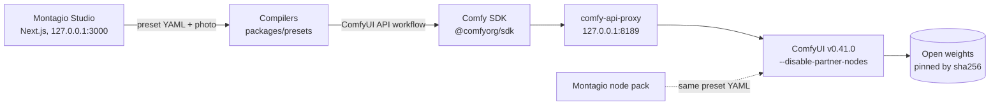

<h1>
  <picture>
    <source media="(prefers-color-scheme: dark)" srcset="docs/brand/montagio-logo.svg">
    
  </picture>
</h1>

Montagio, the open-source Higgsfield alternative.

[](docs/BUILD_NOTES.md#on-the-comfy-developer-platform)
[](#proof-measured)
[](#proof-measured)
[](comfy-nodes/README.md)
[](#credits-and-licenses)

**Click like a one-click video app. Open the hood like ComfyUI.**

Montagio is an open-source AI video studio in the spirit of Higgsfield: drop a photo, pick an effect, a hook or a camera move, and get a clip. Make a talking avatar and translate it, move a character like a dancer, restyle a clip or swap an object in it, remake a trend shot by shot. It runs on your own GPU, for free, with no account, no credits and no paid API, and it ships only open weights licensed Apache-2.0 or MIT. It is built with the [Comfy SDK](https://github.com/Comfy-Org/comfy-typescript-sdk), which drives a local [ComfyUI](https://github.com/Comfy-Org/ComfyUI) v0.41.0 through [comfy-api-proxy](https://github.com/Comfy-Org/comfy-api-proxy).

[Try it](#try-it) · [What you can make](#what-you-can-make) · [Hidden, and why](#hidden-and-why) · [ComfyUI node pack](#the-montagio-node-pack-for-comfyui) · [Proof, measured](#proof-measured) · [Install](#install) · [Roadmap](#roadmap) · [Build notes](docs/BUILD_NOTES.md) · [Licenses](#credits-and-licenses)

## Try it

<!-- TODO before submission: replace the two placeholders below with the showcase's *.hf.space URL and the demo video URL. -->

| | |
|---|---|
| **Showcase** (in your browser, no install) | _TODO: showcase URL_ |
| **Demo video** | _TODO: video URL_ |
| **Your own GPU** | one command, see [Install](#install) |
| **ComfyUI** | the [node pack](comfy-nodes/README.md) and the [workflows](comfy-hub/README.md), ready to load |

The showcase is a static copy of the real Studio. It plays 43 clips pre-rendered with Montagio on open weights, in 1080p: the 11 camera moves on 3 sample photos, 9 clips of the six effects and the Ignite hook. You can assemble a 2–3 shot film in your browser (FFmpeg compiled to WebAssembly), remix a preset and check it, download any clip's ComfyUI workflow and read a camera clip's recipe. It renders nothing on a GPU, takes no upload, costs nothing to host and collects nothing. How it is built and published: [docs/VITRINE.md](docs/VITRINE.md) (in French).

### From an MCP client

Once Montagio runs on your machine, any MCP client (a desktop assistant, an IDE, an agent framework) can drive it through a local MCP server: "animate this photo with Crash Push", "make the dog squish", "generate an image, then apply Explode". The server calls the app's own HTTP API, renders nothing itself and keeps the Studio's consent rule. Setup, the client configuration and the 20 tools, `reproduce` included: [packages/mcp](packages/mcp/README.md).

## Why Montagio

- **Free and local.** ComfyUI, the proxy and the app listen on `127.0.0.1` only, and the app's API refuses another host name and requests from another site. There is no key, no paid API and no credit to buy, and your photos and clips never leave your machine; the trend remix fetches a video from the web only when you give it a link.
- **Open weights only.** Every weight Montagio can download is licensed Apache-2.0 or MIT, read at its source repository and pinned by sha256. There is no partner node, no closed API and no proprietary connector. A CI check, `check-open-stack`, proves it on every commit.
- **Presets are files, not a lock-in.** Every camera move, effect and hook is a YAML file under CC-BY-4.0 that compiles into a ComfyUI workflow. Remix one in the Studio, download the exact workflow behind a clip, or load the same preset in a ComfyUI graph with the [Montagio node pack](comfy-nodes/README.md). Every result carries its recipe, which renders it again.
- **Proven on a real GPU.** Every model below rendered on a 24 GB GPU, an NVIDIA L4, with its time measured; the 12 GB profile was measured on the same card held to 11.5 GiB.

## What you can make

The app opens on the Studio, on its Effects tab (Camera when no effect is installed). **Explore**, behind the logo, shows the clips Montagio makes and a door to every tool. The header leads to Explore, Characters, Ads, the five Studio tabs (Effects, Camera, Film, Avatar, Motion) and History; the Community gallery, the Voice change, the Translation and the Trend remix open from Explore and from the results that feed them.

### A clip from a photo

| Feature | What it does | Model (license) |
|---|---|---|
| **Effects** | One photo, one of six one-photo effects, a 5 s clip: Squish, Explode, Cake-ify, Snap Zoom, Frozen Moment, Full Circle. With **Character · Location · Product**, two or three photos are first composed into one scene by the edit, then the effect plays on it. | Wan 2.1 I2V 480p with effect LoRAs by Remade-AI and a 4-step lightx2v LoRA (Apache-2.0) |
| **Hooks** | A keyframe transition: the edit makes the end frame, the video model animates the way there. Ignite sets the subject on fire; Wardrobe Swap takes an outfit photo too. | Qwen-Image-Edit-2511, then Wan 2.2 FLF2V (Apache-2.0) |
| **Camera** | A photo and one of 11 camera presets give a 5 s clip. You describe what the photo shows, so the model follows the photo instead of inventing it. Three models: **Quality** (20 steps), **Turbo** (the same moves in 4 steps, a little less detail) and **Fast** (Wan 2.2 5B, the move in words); on an RTX 4090 the Studio counts about 9 min, 1 min and 2 min. Turbo is the default of 7 presets; Quality stays the default of Rise & Push, where Turbo lost the subject, and of the three sideways moves (Pan Left, Pan Right, Drift Left Push), since Turbo ghosted a person on Pan Left. | Wan 2.2 Fun Camera 14B, with lightx2v LoRAs for Turbo; Wan 2.2 TI2V 5B (Apache-2.0) |
| **Film** | Two or three camera moves in a row: each shot starts on the last frame of the previous one. The film keeps the photo's shape (16:9, 9:16 or 1:1), always comes with a 9:16 cut, and takes an instrumental track made for it. | the camera models; ACE-Step 1.5 (MIT) for the music |
| **Avatar** | A photo and a text (English or French) give a talking clip of up to 15 s, in the built-in voice or in a **voice sample** its speaker agreed to lend. Under the result: **Captions 9:16** (Whisper hears the clip, you correct the words, pick one of five styles, and the export burns them in with each word timed), **Change the voice**, and **Translate**. | Chatterbox Multilingual (MIT), Wan 2.2 S2V (Apache-2.0), Whisper large-v3 turbo (MIT) |
| **Translation and lip-sync** | A clip that speaks, sent here or made by the avatar, said again in English, French, Spanish, German, Italian, Portuguese, Japanese or Chinese, in the speaker's own voice, with the lips following the new words. | Gemma 4 E4B (Apache-2.0) transcribes then translates, Chatterbox speaks, Wan 2.2 S2V moves the lips |
| **Voice change** | The speech of a clip said again in the voice of a sample its speaker agreed to lend; the words, the rhythm and the picture stay. | Chatterbox VC (MIT) |
| **Motion** | Three modes. **Move a character**: the character of a photo moves like a reference video of up to 30 s, or like one of the seven moves of the **Motion library**, made by Montagio from fictional characters; the character can be **composed** first by the edit from a photo of it, of its outfit and of a product in its hand. **Restyle the clip**: a clip of up to 5 s and a few words rebuild its whole scene, its motion, camera move and timing kept. **Swap an object**: paint an object on the clip's first frame, say what replaces it, and the object is followed through the clip and redrawn, the rest untouched. | Wan2.2-Animate-2, distilled, with the core context windows past 5 s; Wan 2.1 VACE 14B with depth from Depth Anything 3 Small; SAM 2.1 base+ (Apache-2.0) |
| **HD** | "HD 1080p" under a finished clip of 121 frames at most, with **smooth motion** ticked by default: RIFE puts a frame between each two, so a 16 fps clip comes out at 32 fps. "HD 2560 px" under a photo of the atelier or of a character. | SeedVR2 3B (Apache-2.0), RIFE 4.26 (MIT) |

The 11 camera presets are Crash Push, Slow Push, Pull Back Reveal, Pan Left, Pan Right and Crane Up, plus five presets with two moves: Rise & Push, Drift Left Push and Pull Back & Tilt Up run both moves at once; Push & Settle and Breathing run one after the other. The core ComfyUI node takes a single move, so the two-move presets go through a node of the Montagio pack, Montagio Camera Embedding.

### Around the clip

| Feature | What it does | Model (license) |
|---|---|---|
| **Start photo** | No photo? **Write one**, and set the shot with camera, lens, film, light and palette chips (fixed phrases, no brand names). **Edit** one in plain words, with three looks (inflated, figurine, angle of view), six ready-made relights, eight palettes and **inpaint** (paint what changes, the rest stays pixel for pixel). Or **draw** it: a sketch and a few words, and the edit turns the drawing into a photo. | Z-Image-Turbo, Qwen-Image-Edit-2511 with a 4-step Lightning LoRA (Apache-2.0) |
| **Characters** | Make a fictional character from a kind (a person, nine animals, a robot or an alien), a style (everyday, bold, extreme, cartoon, anime, clay), optional traits and a few words, or start from one of **28 ready-made faces**. Save it, then its **photodump**: the same character in the scenes you pick. Any picture opens Camera, Effects, Avatar or Motion with it as the start photo. A character is never a photo of someone. | Z-Image-Turbo and Qwen-Image-Edit-2511 (Apache-2.0) |
| **Ad studio** | A product photo, a character if you like, a style (Studio, Lifestyle, Bold), an effect and a tagline give a 9:16 ad with music: the edit stages the scene with room for the tagline, the effect animates it, ACE-Step writes the music. | Qwen-Image-Edit-2511, Wan 2.1 I2V and an effect LoRA (Apache-2.0), ACE-Step 1.5 (MIT) |
| **Trend remix** | A short video you may use (a file, or a TikTok, Instagram or YouTube Shorts link fetched on your machine by yt-dlp, or Montagio's own example) is cut into its shots; each shot is made again with your character or with one object replaced, on one seed, then put back on the trend's frames and cut to 9:16 with words on screen. Gemma reads the shots' first frames and drafts the caption, the hashtags and the words, all editable. The sound is left out unless you keep it and confirm you may. Nothing is published for you. | Wan2.2-Animate-2 or VACE per shot, Gemma 4 E4B (Apache-2.0) |
| **Remix a preset** | Edit a preset's YAML in the Studio, check it line by line, render it, download it. "Open in ComfyUI", under a finished clip, downloads the exact workflow that ran. | — |
| **Community gallery** | Publish a result from History with a title, remix an entry back into the Studio, or pass it on as a share file: the settings only, never a photo or a clip. | — |
| **Recipe and Reproduce** | Every result carries its recipe: the preset, the exact ComfyUI workflow of each step and its sha256, the weight files with their licences, the seed, the settings and the sha256 of each input, never the photo. A Recipe panel shows it under each result and in History, and a compact copy rides in each exported MP4 and PNG. Reproduce renders a clip or a film again with the same seed and says whether the workflow matches, in the Studio, from a terminal (`npm run reproduce`) or from an MCP client. Ads, voice changes and a film's music keep their recipe without the button. | — |
| **Share 9:16** | Under each finished clip, film, ad, voice change, remix or captions export: a 1080×1920 cut ready for TikTok, Reels and Shorts, with a discreet "Made with Montagio" end card you can untick, and a caption to copy, written on your machine from what the result is (no service is asked). The file keeps its "AI-generated" mention and its recipe, and the caption says it too. | FFmpeg and libass |
| **History** | Every photo, clip and film made on this machine, with download, reuse, publish and its recipe. | — |
| **Open Stack** | One page lists the 19 models and 65 weight files Montagio can run, by what they make, each weight linked to the repository its licence was read from, with the latest open-stack check. Every caption under a result links to its model's line. | — |

### Ten extensions, each validated on a GPU

Beyond the camera models and text to image, every model belongs to an extension. An extension appears in the Studio only once a GPU session has rendered it and dated it in [registry/extensions.yaml](registry/extensions.yaml), and only when its weights are installed.

| Extension | What it adds | Validated |
|---|---|---|
| `edit` | the photo edit, its looks, relights, palettes and inpaint, the drawing, the photodump, the compositions | 2026-10-21; relight and inpaint 2026-10-22 |
| `effects` | the six one-photo effects | 2026-10-21; within 12 GB 2026-10-25 |
| `transitions` | the hooks (needs `edit`) | 2026-10-21: Wardrobe Swap, then Ignite |
| `avatar` | the talking avatar, the voice sample, the voice change, the translation and lip-sync, the captions | 2026-10-21; voice sample and voice change 2026-10-22; lip-sync 2026-10-24; translation and captions 2026-10-25 |
| `music` | the music of a film and of an ad | 2026-10-21 |
| `upscale` | HD 1080p, smooth motion, HD photo | 2026-10-21; HD photo 2026-10-22; smooth motion 2026-10-24 |
| `motion` | the motion transfer, the Motion library, the composed character | 2026-10-21 (5 s); 30 s, the library and the composed character 2026-10-24; a character holding a product 2026-10-25 |
| `restyle` | Restyle | 2026-10-24 |
| `swap` | the object swap (needs `restyle`) | 2026-10-25 |
| `remix` | the trend remix (needs `motion`) | 2026-10-25 |

The order of priority, the cut rule and the reasoning behind every model choice are in [docs/EXTENSIONS_ANALYSE.md](docs/EXTENSIONS_ANALYSE.md) (in French); every render and its verdict, in [docs/S2_RESULTATS.md](docs/S2_RESULTATS.md) (in French).

## Hidden, and why

Montagio shows only what a GPU session rendered well. What it keeps out:

| Not shown | Why |
|---|---|
| The **Iris Dive** and **Figurine** hooks | Iris Dive's single transition from the face to the iris was a cross-fade in 4 steps and grew the iris in the mouth in 20; it needs an intermediate keyframe. Figurine's change was barely visible. Both stay undated, so hidden. The edit's figurine look stays: it was clean. |
| A **moodboard** for text to image, and a **palette taken from a photo** in the edit | On the GPU the moodboard lost the tones of its board, and the palette from a photo copied the photo's content instead of its colours. Both stay behind `MONTAGIO_EXPERIMENTAL`; the eight ready-made palettes are shown. |
| Tilt Down and a Dutch angle | Fun Camera barely moves vertically and does not roll: Tilt Down stayed still even at twice the speed, so it left the library; Tilt Up became Crane Up. |
| In the **12 GB profile**: Quality (20 steps) and every extension but the effects | Only what ran within 12 GB is offered: Turbo, Fast, text to image and the effects. |
| In the **showcase**: uploads and everything that needs them (Characters, Ads, Avatar, Motion, Voice change, Translation, Trend remix, Draw, publishing) | The showcase renders nothing: it plays clips made beforehand. Three effect renders on a person were also kept out of it for what they show. |
| The trend remix's **link import** outside an install of your own | It runs only in the app on your machine, never in the demo mode nor the showcase. |

A first local install fetches the camera models and the effects pack only; `--extensions all` fetches the rest, and the next installs keep that choice ([Install](#install)).

## The Montagio node pack for ComfyUI

> [!NOTE]
> **Two camera moves in one Wan 2.2 Fun Camera clip, and camera presets as files.** The core `WanCameraEmbedding` node takes one move. **Montagio Camera Embedding** takes two, at once or one after the other, as a drop-in replacement. **Load Montagio Preset** turns a preset file into the moves, the size, the frame count, the fps and the prompts of the graph, so a preset menu replaces the rewiring, in a graph or in App Mode. **Montagio Transcribe Words** runs Whisper large-v3 turbo and gives each word its moment, for the captions. The pack ships its example workflow (ComfyUI lists it under Templates), the 11 presets, and tests that compare its values with the app's. It is GPL-3.0, prepared for the Comfy Registry.
>
> [Read about the pack](comfy-nodes/README.md) · [the example workflow](comfy-nodes/example_workflows/montagio-camera-presets.json)


The other pipelines, as plain ComfyUI graphs with their build notes (models and where they go, node map, measures, limits): [comfy-hub/](comfy-hub/README.md). One-photo effect, keyframe hook, talking avatar, motion transfer, HD with smooth motion and film music; all core nodes.

## Proof, measured

GPU session S2 ran on 2026-10-21 on an NVIDIA L4 with 24 GB of VRAM, the memory of the RTX 4090 that Montagio targets. It was the first time anything rendered: before it, every workflow had only been checked by a real ComfyUI with empty model files. Every feature added since that runs a model was rendered the same way before it was shown. The full report, with every verdict: [docs/S2_RESULTATS.md](docs/S2_RESULTATS.md) (in French).

- **687 node classes loaded, 0 partner nodes.** ComfyUI always starts with `--disable-partner-nodes`, and the installer stops everything if `/object_info` shows a partner node.
- **Every weight checked against its sha256.** The lock holds 64 entries, 40 under Apache-2.0 and 24 under MIT, 254 GB in all ([registry/models.lock.yaml](registry/models.lock.yaml)). The downloader refuses a file whose sha256 or size differs; S2 downloaded and checked the 45 entries the lock held then, with no failure.
- **Licenses read at the source.** The license that counts is the one of the source repository, not the one a mirror declares. [allowed-sources.yaml](tools/check-open-stack/allowed-sources.yaml) lists every repository a weight may come from, with the revision read, and refuses the repositories that official templates use but that carry non-commercial or territory-restricted files.
- **Cheap to prove.** S2, the first GPU session, cost $12.94 of rented compute. Each feature added since was validated in a short run, from a few cents (the captions, $0.016) to a few dollars for the largest (the 30 s motion series, $1.70). A 5 s camera clip costs about $0.35–0.40 on a rented L4 in Quality, an effect about $0.05. On your own GPU it costs electricity.

Measured on the L4 (an RTX 4090 is about twice as fast, going by the official templates' timings):

| Job | Time on the L4 | Peak VRAM |
|---|---|---|
| Camera preset, 5 s at 480p, Quality (Fun Camera 14B, 20 steps) | 1,110–1,170 s | 18–21 GB |
| Camera preset, 5 s at 480p, Turbo (the same, 4 steps) | 136–138 s warm, 156 s cold | 22.4 GB |
| Fast mode, 5 s at 480p (Wan 2.2 5B) | 190 s, cold | 21.2 GB |
| Text to image (Z-Image-Turbo) | 9–10 s, warm | 20–22 GB |
| Photo edit, 4 steps (Qwen-Image-Edit-2511) | 20–25 s, warm | 21.5–22.6 GB |
| One-photo effect, 4 steps (Wan 2.1 I2V and LoRA) | 156 s, warm | 21–22.6 GB |
| Composition from three photos, then the effect | 46 s, then 182 s | 22.4 GB |
| Hook transition, 4 steps (Wan 2.2 FLF2V), after the edit | 134–157 s | — |
| Talking avatar, 3–4 s of speech (Wan 2.2 S2V), after the voice | 127–145 s | 21.7 GB |
| Voice (Chatterbox) | 2.5–5 s, warm | 3.3 GB |
| Voice change (Chatterbox VC), a 4 s clip | 23.6 s, cold | 4.3 GB |
| Translation, two passes (Gemma 4 E4B, then Chatterbox) | 43 s, cold | 11.0 GB |
| Lip-sync of the translated speech (Wan 2.2 S2V) | 284 s, cold | 22.2 GB |
| Captions, the words of 2.9 s of speech and their moments (Whisper large-v3 turbo) | 10.5 s, the loading included | 4.9 GB |
| Music, 60 s (ACE-Step 1.5) | 9.5 s, warm | 10–14.6 GB |
| HD upscale, 81 frames to 1080p (SeedVR2 3B) | 428 s | 18.4 GB |
| HD with smooth motion, 81 frames at 16 fps to 161 at 32 fps in 1080p (SeedVR2 3B, then RIFE 4.26) | 410 s, of which RIFE 4.8 s | 8.6 GB |
| HD photo, to 1440×2560 (SeedVR2 3B) | 14 s | 19.9 GB |
| A character's portrait, 9:16 (Z-Image-Turbo), after the first | 8.6–9.3 s | 20.5–22.3 GB |
| Motion transfer, 5 s (Animate-2 distilled) | 391–415 s | 20.1–22.2 GB |
| Motion transfer, 30 s (Animate-2 distilled, 9 context windows) | 3,425 s | 22.6 GB |
| Composed character (edit, two or three photos), then its motion transfer, 5 s | 82–84 s + 425 s | 22.2 GB, 22.6 GB |
| Restyle, 5 s at 480p (VACE 14B, 4 steps), after the edit of its first frame (73 s) | 186–239 s | 22.2–22.5 GB |
| Object swap, 5 s at 480p (SAM 2.1, then VACE 14B, 4 steps), from a text or a photo | 207–252 s | 21.0–22.5 GB |
| Trend remix, three shots of 2 s (Animate-2 distilled, one seed), then their assembly | 166 s for the first shot, 125 s each after | 21.9 GB |
| Trend skeleton and post, a sheet of three shots (Gemma 4 E4B, two passes) | 23 s | 7.9 GB |

The 12 GB profile, on the same L4 held to 11.5 GiB of free VRAM and 32 GiB of RAM, with the same fp8 weights: Turbo 153.5 s, an effect 174 s, Fast 192.9 s, text to image 48 s, each within 11.5 GiB.

Every measure, with its date, cold and warm, and the ad, drawing, character and relight runs: [docs/BUILD_NOTES.md](docs/BUILD_NOTES.md#measured-on-a-gpu).

What the sessions taught, and changed:

- **The photo's description is required.** Without a text saying what the photo shows, Fun Camera invents and the clip turns ghostly: the diagnosis changed one variable per clip, and the description alone fixed it. The Studio now asks for it, and fills it in whenever the photo's text is known.
- **HD goes through the upscale.** 480p followed by SeedVR2 gives 1080p about three times faster than rendering 720p natively.
- **Turbo keeps the moves.** The 4-step LoRAs distil the denoising, while the camera path still drives the move: 11 of 13 Turbo clips kept it, 8.3 times faster. The two failures set the defaults above.
- **Honest limits.** Fun Camera handles push-ins, pull-backs and side moves well, and vertical moves and rotation poorly. The avatar's built-in voice is male, whatever the face: a consented voice sample replaces it. Motion transfer needs a photo framed like the reference video. Restyle from a text alone rebuilds the scene but keeps a realistic look: an asked style holds once the edit has restyled the first frame, or with an image to follow. A composed character keeps the product in its hand once the product comes before the outfit in the edit's images; after it, a toy car became a bottle, then a phone. Gemma reads only the first frame of each shot of a trend, so a dance whose dancers stand still at the start reads as a still pose.

## How it works



- A preset is a YAML file. The compiler fills a ComfyUI workflow converted from the official [Comfy-Org workflow templates](https://github.com/Comfy-Org/workflow_templates); every change from a template, and the five workflows written for Montagio where no template exists, are listed in [workflows/README.md](workflows/README.md).
- The app talks to ComfyUI only through the Comfy SDK and comfy-api-proxy: `workflows.fromJson`, `assets.fromFile`, `submit`, then `jobs.get` until the output is ready. The base URL is explicit and local, the SDK's `fetch` refuses any other origin, and no Comfy API key ever reaches it.
- FFmpeg assembles films and remixes, mixes the music, cuts 9:16 and burns the captions in with libass. Every clip, image and sound gets the "AI-generated" mention in its metadata, and every clip and image its recipe.
- Everything is core ComfyUI nodes, apart from the Montagio node pack and two pinned third-party node packs: the voice node, patched, and the object swap's SAM 2 tracker.

The path of a request, the workflows behind each feature, every measure and the design choices: [docs/BUILD_NOTES.md](docs/BUILD_NOTES.md).

| Folder | What |
|---|---|
| [apps/web](apps/web) | the Studio and its server routes |
| [packages](packages) | the compilers, the model registry, the ComfyUI adapter, the assembly (FFmpeg), the captions, the recipes, the showcase builder, the [MCP server](packages/mcp/README.md) |
| [presets](presets) | the camera presets, [effects](presets/effects), [hooks](presets/transitions) and the [Motion library](presets/motions), in YAML |
| [registry](registry) | the models, the extensions and the weights lock |
| [workflows](workflows) | the ComfyUI workflows, in API format |
| [comfy-nodes](comfy-nodes/README.md) | the Montagio node pack for ComfyUI |
| [comfy-hub](comfy-hub/README.md) | the main pipelines as ComfyUI graphs, with their build notes |
| [infra](infra) | the local installer, and the GPU-session tooling ([Modal](infra/modal/README.md), [Runpod](infra/runpod/README.md)) |
| [tools/check-open-stack](tools/check-open-stack) | the open-stack check |

## Install

Clone this repository, then, from its folder, one command checks your machine, installs ComfyUI, comfy-api-proxy, the node pack, the weights and the app, then opens the Studio at `http://127.0.0.1:3000`.

Linux:

```bash
./montagio.sh install
```

Windows (PowerShell):

```powershell
powershell -ExecutionPolicy Bypass -File .\montagio.ps1 install
```

| You need | |
|---|---|
| GPU | NVIDIA with 24 GB of VRAM (RTX 3090, RTX 4090, L4, A10, A5000…) and a driver for CUDA 12.8 or newer (R570; R580 for the CUDA 13.0 build of PyTorch); with 12 to 20 GB, the 12 GB profile (`--low-vram`) |
| System | Windows 10 or 11 (x64), or Linux x64; macOS is not supported |
| RAM | 32 GB or more recommended |
| Disk | about 114 GB free by default |
| Tools | Node.js 22.23.4+ or 24.22.1+, Python 3.11–3.13 (3.12 on Windows for the avatar's voice), git, FFmpeg; the installer prints the command that installs whatever is missing |

What gets downloaded:

| Option | Weights | Disk the installer asks for |
|---|---|---|
| default | the camera models and the effects pack (93 GB) | about 114 GB |
| `--extensions all` | every extension, with the node packs of the avatar and the object swap (253 GB on disk) | about 275 GB |
| `--extensions none` | the camera models alone (72 GB) | about 93 GB |
| `--app-only` | none: the app alone, in demo mode or rendering on a remote GPU with `--proxy-url` | — |

Add `--dry-run` to see every step without changing anything. A stopped download resumes when you run the same command again. The extensions you ask for are kept for the next runs, so a plain `install` updates them; `--extensions default` goes back to the effects pack. Asked for, the talking avatar (and with it the voice change, the translation and the captions) and the object swap come with the custom node each runs on, cloned at a pinned commit: the voice node, patched to remove its HTTP routes, with its Python packages pinned by hash, and the SAM 2 tracker. A node that fails to install leaves its extension out, not the rest of the install.

Everything else, from the 12 GB profile and everyday commands to troubleshooting and uninstalling: [docs/INSTALL.md](docs/INSTALL.md).

## Roadmap

The next steps follow the same rule as everything above: an open model enters the weight lock only once its license, read at the source, is Apache-2.0 or MIT with no added condition, and a feature reaches the Studio only once a GPU session has validated it. They are sorted by how much they take.

**Within reach: the models are already here, or the work is outside the models.**

| Area | Next step |
|---|---|
| Photo description | fill in "What the photo shows" automatically with a small open captioning model (Florence-2 is the candidate, its weights and node to be read at the source), the field staying editable |
| Hooks | Iris Dive with an intermediate keyframe, a stronger Figurine, Earth Zoom Out in five keyframes, all on the edit and FLF2V already in the lock |
| Camera moves | orbits and bullet time from keyframes: Edit-2511 viewpoints, then Wan 2.2 FLF2V; Quality in the 12 GB profile once a render there validates it |
| Style from an image | the moodboard and the palette from a photo, through a style described in words (Gemma reads the images, the text-to-image model follows the words) |
| Music | songs with lyrics on ACE-Step 1.5 |
| Trend remix | a frame from the middle of each shot for Gemma, so that the post reads the motion |
| Install | a container image |
| Restyle and object swap | longer clips over several VACE windows, several objects swapped at once, on the weights already here |
| ComfyUI | the node pack published on the Comfy Registry, the workflows on the Comfy Hub (both prepared) |
| Provenance | C2PA manifests on every output (c2pa-python, Apache-2.0) |

**One new open model to validate on 24 GB.**

| Area | Next step, with the open model planned |
|---|---|
| Image | posters with legible text: Qwen-Image-2512 (Apache-2.0) |
| Voice | a more natural voice in more languages: Qwen3-TTS (Apache-2.0) |
| Talking avatar | longer takes: LongCat-Video-Avatar (MIT) |
| Consistent character in video | Phantom (Apache-2.0) |
| Finishing | background removal: BiRefNet, pending a license check at the source |
| Director | an open LLM of the Qwen3 family (Apache-2.0) that turns a short script into a shot list of presets |
| Motion transfer | dance driven by the film's music: Wan-Dancer, once its license is read |

**Larger: a new model family, long video or training.**

| Area | Next step, with the open model planned |
|---|---|
| Long video | minute-long clips: LongCat-Video (MIT), MAGI-1 (Apache-2.0) |
| Character | a character LoRA trained in the app, with recorded consent (Z-Image or Qwen-Image) |
| New effects | an Apache-2.0 Earth Zoom Out LoRA trained on Montagio's own keyframe chains; a camera LoRA trained on synthetic renders |
| Sound | a video model with native sound, and foley, under a truly free license: none passes the rule yet |
| Running elsewhere | one adapter that runs these same open weights on any rented GPU |

Never on the roadmap:
- connectors to closed video APIs (Seedance, Kling, Veo…), partner nodes, or models reached through the Comfy Router;
- weights under a non-commercial, revenue-threshold or territory-restricted license (LTX-2.5, FLUX.3 klein, MiniMax H3, HunyuanVideo…);
- face swap built on InsightFace, selfies with celebrities, and anything not safe for work.

## Responsible use

Do not make videos of real people without their consent, nothing illegal and nothing not safe for work.

- Before an edit, an effect, a hook, an avatar, an ad or a composition on an uploaded photo, the Studio asks you to confirm that you are the person in it or have their consent. Ready-made faces, sample photos and pictures made from a text need no box: they show no one.
- Motion transfer, Restyle and the object swap ask you to confirm that you hold the rights on the video and the images; the object swap also that the people filmed agree, and it warns never to replace a real person without their consent nor to pass the result off as filmed. The Motion library's moves show fictional characters made by Montagio: no rights to clear.
- A voice sample, for the avatar or the voice change, needs its speaker's agreement; a translation, the agreement of the person shown to speak another language in their own voice.
- The trend remix asks you to confirm that you may use the video and that the people filmed agree, and, for each photo, that its person is you, agreed, or is fictional: that box is ticked every time, never deduced from a file sent. A link is fetched only from TikTok, Instagram or YouTube Shorts, checked by name before anything runs, 60 s and 50 MB at most; it is never written in a recipe. A remix of a trend that is not Montagio's example cannot be shared in the community gallery.
- A character is fictional: it comes from a text or a ready-made face, never from a photo of someone, and its portrait is always asked fully clothed.
- A [list of well-known names](registry/blocked-names.txt) is refused in every text typed in the app (prompts, a camera clip's or a film's description of the photo, a remixed move, the edit, the effects, the avatar, a film's music, the motion transfer, Restyle, the object swap, the ads, the characters, the trend remix, the gallery) and in share files. It is a good-faith guardrail, not a complete filter.
- A [list of explicit sexual terms](registry/blocked-terms.txt) is checked in those same texts, as whole words or phrases, and refused with `blocked-term`. This filter is on by default. On your own local backend only, `MONTAGIO_CONTENT_FILTER=off` turns it off; the name, consent, rights, host and file checks stay active. It is a good-faith textual guardrail, not complete moderation.
- Every clip, image and sound is tagged "AI-generated" in its metadata, beside its recipe, and the Studio shows the mention under each result with the model and its license. A recipe never gives the consent or the rights.
- What you render locally is your responsibility: these text checks cannot see what an image or a clip contains.

Security issues, and what the local API refuses: [SECURITY.md](SECURITY.md).

## Credits and licenses

| Montagio part | License |
|---|---|
| App and server ([apps/](apps), root) | [AGPL-3.0-only](LICENSE) |
| Libraries ([packages/](packages), [tools/](tools)) | Apache-2.0 |
| GPU-session tooling and installer ([infra/](infra)) | Apache-2.0 |
| ComfyUI node pack ([comfy-nodes/](comfy-nodes)) | [GPL-3.0-only](comfy-nodes/LICENSE) |
| Preset library ([presets/](presets)) | [CC-BY-4.0](presets/LICENSE) |

**Model weights** keep their own licenses, all Apache-2.0 or MIT, and are downloaded from their repositories, never bundled. Most files come from Comfy-Org's repackaged mirrors; the license that counts is the source's. Thanks to the teams who published them:
- Wan-AI and alibaba-pai (Wan 2.1 and Wan 2.2: Fun Camera, TI2V 5B, I2V, FLF2V, S2V, Animate-2, VACE 14B), Apache-2.0;
- Tongyi-MAI (Z-Image-Turbo) and Qwen (Qwen-Image-Edit-2511, Qwen-Image, Qwen2.5-VL, Qwen3 encoders), Apache-2.0;
- Google (Gemma 4 E4B, umt5-xxl), ByteDance-Seed (SeedVR2), the Depth Anything team (Depth Anything 3 Small), Black Forest Labs (FLUX.1-schnell autoencoder), Apache-2.0;
- ACE-Step (ACE-Step 1.5), Resemble AI (Chatterbox), OpenAI (Whisper large-v3 turbo), LAION (CLIP ViT-H-14) and hzwer (RIFE 4.26), MIT;
- lightx2v (Lightning LoRAs), Remade-AI (effect LoRAs), systms and fal (edit looks), and the wav2vec2 authors, Apache-2.0;
- Meta (SAM 2.1, in Kijai's safetensors, checked tensor for tensor against Meta's checkpoint), Apache-2.0.

Every file, with its source, revision and sha256, is in [registry/models.lock.yaml](registry/models.lock.yaml).

**Code Montagio builds on:**
- [ComfyUI](https://github.com/Comfy-Org/ComfyUI) v0.41.0 (GPL-3.0), installed beside Montagio, never bundled;
- the [Comfy SDK](https://github.com/Comfy-Org/comfy-typescript-sdk) (`@comfyorg/sdk`) and [comfy-api-proxy](https://github.com/Comfy-Org/comfy-api-proxy), MIT;
- the [Comfy-Org workflow templates](https://github.com/Comfy-Org/workflow_templates) at commit `59a3b48b`, MIT, which the Montagio workflows are converted from, except five written where no template exists ([license text](workflows/LICENSE.workflow_templates));
- [wildminder/ComfyUI-Chatterbox](https://github.com/wildminder/ComfyUI-Chatterbox) at commit `4597af8f` (Apache-2.0), the voice node, pinned and patched to remove its HTTP routes and read its Chinese table from the model folder ([patch](infra/runpod/patches/comfyui-chatterbox-no-routes.patch));
- [kijai/ComfyUI-segment-anything-2](https://github.com/kijai/ComfyUI-segment-anything-2) at commit `0c35fff5` (Apache-2.0), the object swap's tracking nodes, pinned and unchanged: they open no HTTP route and need no Python package ComfyUI lacks;
- [yt-dlp](https://github.com/yt-dlp/yt-dlp) 2026.10.21 (Unlicense), the trend remix's link importer: the release binary, checked by its sha256, downloaded by the local installer and never bundled;
- [ffmpeg.wasm](https://github.com/ffmpegwasm/ffmpeg.wasm) in the showcase, whose license texts ship beside it;
- the caption fonts Poppins, Anton, Bebas Neue and Montserrat, SIL OFL 1.1, embedded with their licences ([apps/web/public/fonts/captions](apps/web/public/fonts/captions/README.md)).

## Contributing

Contributions are welcome under the Developer Certificate of Origin (`git commit -s`), with no CLA: see [CONTRIBUTING.md](CONTRIBUTING.md). A new model is accepted only under Apache-2.0 or MIT, read at its source, and `npm run check:open-stack` must pass.

## Context

Montagio is built for Comfy's "Open Source Higgsfield" challenge (October 2026), in the Open Weights Only category: no partner node, no closed API, open weights only. A rented GPU served only for the test renders and the showcase's clips. It is an independent community project, not affiliated with Higgsfield or with any company whose product it is compared to. It uses none of their code, assets, texts, outputs or preset names.
