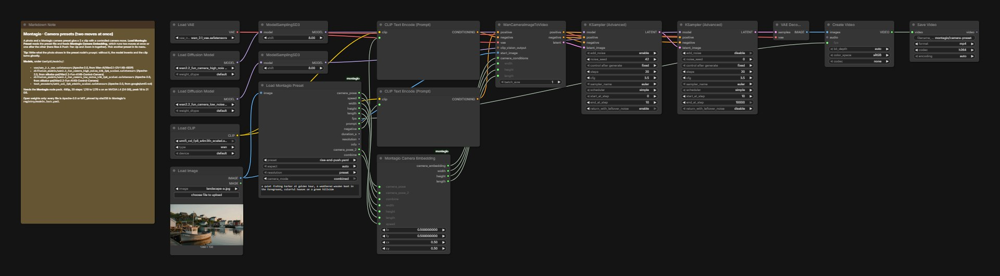

# Camera presets: two moves in one clip

A photo and a Montagio camera preset give a 5 s clip with a controlled camera move. The preset is a small YAML file: **Load Montagio Preset** reads it and feeds **Montagio Camera Embedding**, which runs two moves at once or one after the other, something the core `WanCameraEmbedding` node cannot do. The example is Rise & Push, Pan Up and Zoom In together, on the fishing-harbour photo of the showcase.

## Run it in ComfyUI

1. ComfyUI v0.41.0 or newer. Montagio starts it with `--disable-partner-nodes`: nothing in this graph needs a partner node or an API key.
2. Custom nodes: the **Montagio node pack** ([`comfy-nodes/`](../comfy-nodes/README.md), GPL-3.0): copy it to `ComfyUI/custom_nodes/montagio`, or install it from the Comfy Registry once it is published. Everything else is core ComfyUI.
3. Put the model files below under `ComfyUI/models/` (37.6 GB in all).
4. Drag [`workflows/montagio-camera-presets.json`](workflows/montagio-camera-presets.json) onto the canvas, load your inputs (see the node map), then run it. The note in the graph repeats the model list.

## Models

| File | Put under `ComfyUI/models/` | Size | License, source |
|---|---|---|---|
| `wan_2.1_vae.safetensors` | `vae/` | 0.3 GB | Apache-2.0, [Wan-AI/Wan2.1-I2V-14B-480P](https://huggingface.co/Wan-AI/Wan2.1-I2V-14B-480P) |
| `wan2.2_fun_camera_high_noise_14B_fp8_scaled.safetensors` | `diffusion_models/` | 15.3 GB | Apache-2.0, [alibaba-pai/Wan2.2-Fun-A14B-Control-Camera](https://huggingface.co/alibaba-pai/Wan2.2-Fun-A14B-Control-Camera) |
| `wan2.2_fun_camera_low_noise_14B_fp8_scaled.safetensors` | `diffusion_models/` | 15.3 GB | Apache-2.0, [alibaba-pai/Wan2.2-Fun-A14B-Control-Camera](https://huggingface.co/alibaba-pai/Wan2.2-Fun-A14B-Control-Camera) |
| `umt5_xxl_fp8_e4m3fn_scaled.safetensors` | `text_encoders/` | 6.7 GB | Apache-2.0, [google/umt5-xxl](https://huggingface.co/google/umt5-xxl) |

The download URLs and sha256 of every file are in [`registry/models.lock.yaml`](../registry/models.lock.yaml). Each license was read at the source repository, not at the mirror: see [`tools/check-open-stack/allowed-sources.yaml`](../tools/check-open-stack/allowed-sources.yaml).

## Comfy workflow

| Node | Type | What to set |
|---|---|---|
| `97` | Load Image | the start photo |
| `200` | Load Montagio Preset | `preset`: the camera move (11 presets bundled); `prompt`: what the photo shows; `camera_mode` stays `combined` |
| `108` | Montagio Camera Embedding | fed by the preset node: both moves, their speed, the size and the length |
| `102` | KSampler (Advanced) | `noise_seed` |
| `106` | Save Video | the clip, MP4 H.264 |

The node ids are those of the API workflow the Montagio app compiles, so this graph and the app's jobs match node for node, with two differences: node `200`, the preset node, is an addition (the app writes the preset's values into node `108` itself), and the output prefixes remain distinct: node `106` saves under `montagio/camera-preset`, while the app's job saves under `montagio/clip`. To keep a change, save the graph from ComfyUI (this format), or export it as API JSON for a script.

## Measured

On an NVIDIA L4 with 24 GB of VRAM, the memory of an RTX 4090 (which is about twice as fast). 480p, 20 steps (10 on the high-noise model, then 10 on the low-noise one): 1,110 to 1,170 s, peak 18 to 21 GB. The same graph at 720p took 4,331 s; Montagio renders 480p and gets 1080p from the [HD workflow](montagio-hd-smooth.md) instead, about three times faster. Every measure, with its date: [`docs/BUILD_NOTES.md`](../docs/BUILD_NOTES.md#measured-on-a-gpu).

**Turbo, 4 steps.** In the app, 7 of the 11 presets start on the Turbo model: this graph with the template's 4-step group, two LoRAs (`wan2.2_i2v_lightx2v_4steps_lora_v1_high_noise.safetensors` and `wan2.2_i2v_lightx2v_4steps_lora_v1_low_noise.safetensors`, under `loras/`, 1.2 GB each, Apache-2.0, [lightx2v/Wan2.2-Lightning](https://huggingface.co/lightx2v/Wan2.2-Lightning)) and 4 steps at cfg 1, split at step 2. This folder has no graph of it; its API workflow is [`workflows/wan22-fun-camera-turbo.api.json`](../workflows/wan22-fun-camera-turbo.api.json). On the L4 (2026-10-25): 156 s cold, then 136 to 138 s a clip warm, 8.3 times faster than 20 steps, with a little less fine detail; peak 22.4 GB, because ComfyUI's dynamic VRAM fills the card. On an L4 held to 11.5 GiB free, the size of a 12 GB card, Crash Push took 153.5 s. In 4 steps Pan Left doubled a person into a ghost and Rise & Push lost its subject, so those two, Pan Right and Drift Left Push start on 20 steps. Details in French: [`docs/S2_RESULTATS.md`](../docs/S2_RESULTATS.md), parts 14 and 15.

## Example

[`demo-assets/showcase/samples/landscape-a.jpg`](../demo-assets/showcase/samples/landscape-a.jpg), made by Z-Image-Turbo (no real place or person). Previews of the 11 presets: [`presets/previews/`](../presets/previews).

## Limits

- 5 s at 16 fps, 832×480 (480×832 for a portrait photo, 640×640 for a square one).
- Write what the photo shows before the preset's text: without it, the model invents and the clip turns ghostly (measured in GPU session S2, one variable changed per clip).
- Push-ins, pull-backs and side moves read well; vertical moves and rolls barely show on Fun Camera.

## License

The graph is converted from the official [Comfy-Org workflow templates](https://github.com/Comfy-Org/workflow_templates) (MIT, [license text](../workflows/LICENSE.workflow_templates)), like most Montagio workflows; the five with no template (the voice, the voice change, the translation, the captions and the trend post) are written for Montagio ([`workflows/README.md`](../workflows/README.md#extension-workflows)). Every model file is Apache-2.0 or MIT. The Montagio nodes are GPL-3.0-only, the presets CC-BY-4.0.
