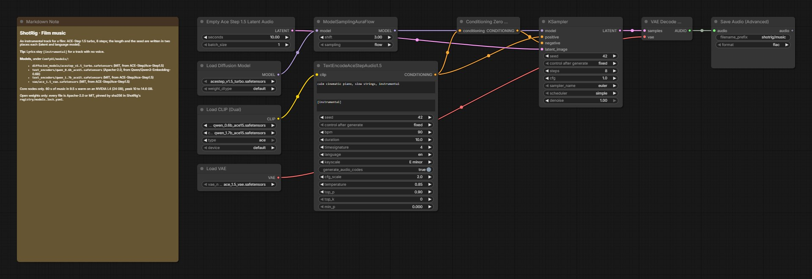

# Film music

An instrumental track for a film: ACE-Step 1.5 turbo in 8 steps. The length and the seed are each written twice, for the latent and for the language model that writes the audio codes.

## Run it in ComfyUI

1. ComfyUI v0.41.0 or newer. Montagio starts it with `--disable-partner-nodes`: nothing in this graph needs a partner node or an API key.
2. Custom nodes: none, core ComfyUI nodes only.
3. Put the model files below under `ComfyUI/models/` (10.0 GB in all).
4. Drag [`workflows/montagio-film-music.json`](workflows/montagio-film-music.json) onto the canvas, load your inputs (see the node map), then run it. The note in the graph repeats the model list.

## Models

| File | Put under `ComfyUI/models/` | Size | License, source |
|---|---|---|---|
| `acestep_v1.5_turbo.safetensors` | `diffusion_models/` | 4.8 GB | MIT, [ACE-Step/Ace-Step1.5](https://huggingface.co/ACE-Step/Ace-Step1.5) |
| `qwen_0.6b_ace15.safetensors` | `text_encoders/` | 1.2 GB | Apache-2.0, [Qwen/Qwen3-Embedding-0.6B](https://huggingface.co/Qwen/Qwen3-Embedding-0.6B) |
| `qwen_1.7b_ace15.safetensors` | `text_encoders/` | 3.7 GB | MIT, [ACE-Step/Ace-Step1.5](https://huggingface.co/ACE-Step/Ace-Step1.5) |
| `ace_1.5_vae.safetensors` | `vae/` | 0.3 GB | MIT, [ACE-Step/Ace-Step1.5](https://huggingface.co/ACE-Step/Ace-Step1.5) |

The download URLs and sha256 of every file are in [`registry/models.lock.yaml`](../registry/models.lock.yaml). Each license was read at the source repository, not at the mirror: see [`tools/check-open-stack/allowed-sources.yaml`](../tools/check-open-stack/allowed-sources.yaml).

## Comfy workflow

| Node | Type | What to set |
|---|---|---|
| `94` | TextEncodeAceStepAudio1.5 | the description, `[Instrumental]` as lyrics, the tempo, the length and the seed |
| `98` | EmptyAceStep1.5LatentAudio | the length, in seconds |
| `3` | KSampler | `seed` |
| `107` | SaveAudioAdvanced | FLAC, 48 kHz stereo |

The node ids are those of the API workflow the Montagio app compiles, so this graph and the app's jobs match node for node, except that node `107` saves under `montagio/music`, where the app's job saves under `montagio/music`. To keep a change, save the graph from ComfyUI (this format), or export it as API JSON for a script.

## Measured

On an NVIDIA L4 with 24 GB of VRAM, the memory of an RTX 4090 (which is about twice as fast). 60 s of music in 9.5 s warm; 10 s in 32 s cold; peak 10 to 14.6 GB. No voice was heard. Every measure, with its date: [`docs/BUILD_NOTES.md`](../docs/BUILD_NOTES.md#measured-on-a-gpu).

## Example

Montagio's ad studio uses this graph for the music of a 10 s ad.

## Limits

- Montagio mixes the track under the film and its 9:16 cut with FFmpeg, keeping every frame and the exact length.
- Keep the length and the seed the same in both places.

## License

The graph is converted from the official [Comfy-Org workflow templates](https://github.com/Comfy-Org/workflow_templates) (MIT, [license text](../workflows/LICENSE.workflow_templates)), like most Montagio workflows; the five with no template (the voice, the voice change, the translation, the captions and the trend post) are written for Montagio ([`workflows/README.md`](../workflows/README.md#extension-workflows)). Every model file is Apache-2.0 or MIT.
