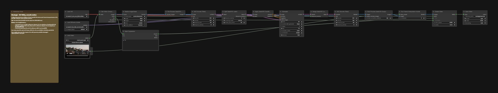

# HD 1080p with smooth motion

A 480p clip at 16 fps becomes 1080p at 32 fps: SeedVR2 3B restores every frame, in temporal chunks of 33 frames with an overlap of 3, then RIFE 4.26 puts a frame between each two. All of it is core ComfyUI.

## Run it in ComfyUI

1. ComfyUI v0.41.0 or newer. Montagio starts it with `--disable-partner-nodes`: nothing in this graph needs a partner node or an API key.
2. Custom nodes: none, core ComfyUI nodes only (`SeedVR2*`, `FrameInterpolationModelLoader`, `FrameInterpolate`, `ComfyMathExpression`).
3. Put the model files below under `ComfyUI/models/` (4.0 GB in all).
4. Drag [`workflows/montagio-hd-smooth.json`](workflows/montagio-hd-smooth.json) onto the canvas, load your inputs (see the node map), then run it. The note in the graph repeats the model list.

## Models

| File | Put under `ComfyUI/models/` | Size | License, source |
|---|---|---|---|
| `seedvr2_ema_vae_fp16.safetensors` | `vae/` | 0.5 GB | Apache-2.0, [ByteDance-Seed/SeedVR2-3B](https://huggingface.co/ByteDance-Seed/SeedVR2-3B) |
| `seedvr2_3b_int8_convrot.safetensors` | `diffusion_models/` | 3.5 GB | Apache-2.0, [ByteDance-Seed/SeedVR2-3B](https://huggingface.co/ByteDance-Seed/SeedVR2-3B) |
| `rife_v4.26.safetensors` | `frame_interpolation/` | 0.0 GB | MIT, [hzwer/RIFE](https://huggingface.co/hzwer/RIFE) |

The download URLs and sha256 of every file are in [`registry/models.lock.yaml`](../registry/models.lock.yaml). Each license was read at the source repository, not at the mirror: see [`tools/check-open-stack/allowed-sources.yaml`](../tools/check-open-stack/allowed-sources.yaml).

## Comfy workflow

| Node | Type | What to set |
|---|---|---|
| `73` | Load Video | the clip |
| `57` | Resize Image/Mask | the output size: 1920×1080, 1080×1920 or 1080×1080, by the clip's shape |
| `54` | KSampler | `seed`; one step, cfg 1 |
| `76` | Save Video | the 1080p clip, at twice the frame rate |

The node ids are those of the API workflow the Montagio app compiles, so this graph and the app's jobs match node for node, except that node `76` saves under `montagio/upscale`, where the app's job saves under `montagio/upscale`. To keep a change, save the graph from ComfyUI (this format), or export it as API JSON for a script.

## Measured

On an NVIDIA L4 with 24 GB of VRAM, the memory of an RTX 4090 (which is about twice as fast). 81 frames to 161 at 32 fps in 1080p: 410 s cold, loading included, of which RIFE takes 4.8 s; peak 8.6 GB. SeedVR2 alone, in GPU session S2: 428 s, peak 18.4 GB. Every measure, with its date: [`docs/BUILD_NOTES.md`](../docs/BUILD_NOTES.md#measured-on-a-gpu).

## Example

[`presets/previews/crash-push.mp4`](../presets/previews/crash-push.mp4), a 480p gallery clip of the same kind; the run of 2026-10-24 smoothed a Crash Push of the harbour rendered that day.

## Limits

- Montagio offers it on clips of 121 frames at most.
- Against a plain lanczos upscale, SeedVR2 is clearly sharper, with no over-sharpening and no visible seam between chunks.
- The chunking is fixed (`manual`): the `auto` mode depends on the free VRAM, so its seams would move from one render to the next.

## License

The graph is converted from the official [Comfy-Org workflow templates](https://github.com/Comfy-Org/workflow_templates) (MIT, [license text](../workflows/LICENSE.workflow_templates)), its RIFE part written for Montagio, like most Montagio workflows; the five with no template (the voice, the voice change, the translation, the captions and the trend post) are written for Montagio ([`workflows/README.md`](../workflows/README.md#extension-workflows)). Every model file is Apache-2.0 or MIT.
