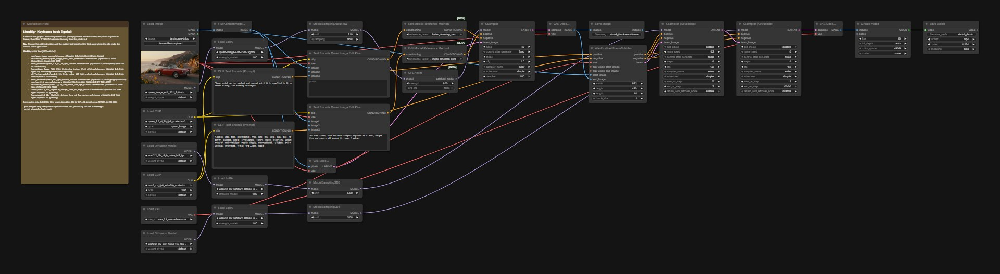

# Keyframe hook

A hook in one graph: the photo edit makes the frame the clip ends on, then a first-last-frame video model animates the way there. The example is Ignite: Qwen-Image-Edit-2511 (4 steps) sets the subject on fire, then Wan 2.2 FLF2V (4 steps) turns the photo into that burning end frame.

## Run it in ComfyUI

1. ComfyUI v0.41.0 or newer. Montagio starts it with `--disable-partner-nodes`: nothing in this graph needs a partner node or an API key.
2. Custom nodes: none, core ComfyUI nodes only.
3. Put the model files below under `ComfyUI/models/` (69.1 GB in all).
4. Drag [`workflows/montagio-keyframe-hook.json`](workflows/montagio-keyframe-hook.json) onto the canvas, load your inputs (see the node map), then run it. The note in the graph repeats the model list.

## Models

| File | Put under `ComfyUI/models/` | Size | License, source |
|---|---|---|---|
| `qwen_image_vae.safetensors` | `vae/` | 0.3 GB | Apache-2.0, [Qwen/Qwen-Image](https://huggingface.co/Qwen/Qwen-Image) |
| `qwen_image_edit_2511_fp8mixed.safetensors` | `diffusion_models/` | 20.5 GB | Apache-2.0, [Qwen/Qwen-Image-Edit-2511](https://huggingface.co/Qwen/Qwen-Image-Edit-2511) |
| `qwen_2.5_vl_7b_fp8_scaled.safetensors` | `text_encoders/` | 9.4 GB | Apache-2.0, [Qwen/Qwen2.5-VL-7B-Instruct](https://huggingface.co/Qwen/Qwen2.5-VL-7B-Instruct) |
| `Qwen-Image-Edit-2511-Lightning-4steps-V1.0-bf16.safetensors` | `loras/` | 0.8 GB | Apache-2.0, [lightx2v/Qwen-Image-Edit-2511-Lightning](https://huggingface.co/lightx2v/Qwen-Image-Edit-2511-Lightning) |
| `wan2.2_i2v_high_noise_14B_fp8_scaled.safetensors` | `diffusion_models/` | 14.3 GB | Apache-2.0, [Wan-AI/Wan2.2-I2V-A14B](https://huggingface.co/Wan-AI/Wan2.2-I2V-A14B) |
| `umt5_xxl_fp8_e4m3fn_scaled.safetensors` | `text_encoders/` | 6.7 GB | Apache-2.0, [google/umt5-xxl](https://huggingface.co/google/umt5-xxl) |
| `wan_2.1_vae.safetensors` | `vae/` | 0.3 GB | Apache-2.0, [Wan-AI/Wan2.1-I2V-14B-480P](https://huggingface.co/Wan-AI/Wan2.1-I2V-14B-480P) |
| `wan2.2_i2v_low_noise_14B_fp8_scaled.safetensors` | `diffusion_models/` | 14.3 GB | Apache-2.0, [Wan-AI/Wan2.2-I2V-A14B](https://huggingface.co/Wan-AI/Wan2.2-I2V-A14B) |
| `wan2.2_i2v_lightx2v_4steps_lora_v1_high_noise.safetensors` | `loras/` | 1.2 GB | Apache-2.0, [lightx2v/Wan2.2-Lightning](https://huggingface.co/lightx2v/Wan2.2-Lightning) |
| `wan2.2_i2v_lightx2v_4steps_lora_v1_low_noise.safetensors` | `loras/` | 1.2 GB | Apache-2.0, [lightx2v/Wan2.2-Lightning](https://huggingface.co/lightx2v/Wan2.2-Lightning) |

The download URLs and sha256 of every file are in [`registry/models.lock.yaml`](../registry/models.lock.yaml). Each license was read at the source repository, not at the mirror: see [`tools/check-open-stack/allowed-sources.yaml`](../tools/check-open-stack/allowed-sources.yaml).

## Comfy workflow

| Node | Type | What to set |
|---|---|---|
| `41` | Load Image | the photo, read by the edit and used as the first frame |
| `151` | TextEncodeQwenImageEditPlus | the edit instruction: what the end frame shows |
| `1006` | CLIP Text Encode | how the clip gets there |
| `169` | KSampler | the edit's `seed` |
| `1057` | KSampler (Advanced) | the video's `noise_seed` |
| `9` | Save Image | the end frame |
| `1061` | Save Video | the clip |

The node ids are those of the API workflow the Montagio app compiles, so this graph and the app's jobs match node for node (the transition's nodes are numbered from 1000: node `1006` is node `6` of the app's transition job, and the end frame goes straight from the edit's decoder to node `1067` instead of through a file). To keep a change, save the graph from ComfyUI (this format), or export it as API JSON for a script.

## Measured

On an NVIDIA L4 with 24 GB of VRAM, the memory of an RTX 4090 (which is about twice as fast). The edit takes 20 to 25 s warm in 4 steps, peak 21.5 to 22.6 GB; the transition 134 to 157 s in 4 steps (1,084 s in 20). The second half loads another model family. Every measure, with its date: [`docs/BUILD_NOTES.md`](../docs/BUILD_NOTES.md#measured-on-a-gpu).

## Example

[`demo-assets/showcase/samples/landscape-b.jpg`](../demo-assets/showcase/samples/landscape-b.jpg) (Z-Image-Turbo). The texts of every hook: [`presets/transitions/`](../presets/transitions).

## Limits

- 480p, 16 fps, up to 5 s.
- Wardrobe Swap is the same graph with a second photo, the outfit, on `image2` of both edit encoders, and its own two texts (`presets/transitions/wardrobe-swap.yaml`).
- Iris Dive and Figurine are not validated: Iris Dive needs an intermediate keyframe, and Figurine's change is barely visible.

## License

The graph is converted, like every Montagio workflow but the voice's, from the official [Comfy-Org workflow templates](https://github.com/Comfy-Org/workflow_templates) (MIT, [license text](../workflows/LICENSE.workflow_templates)). Every model file is Apache-2.0 or MIT.
