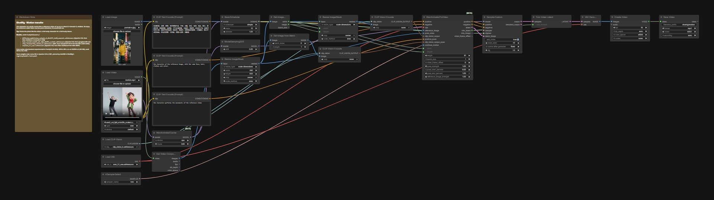

# Motion transfer

The character of a photo moves like a reference video: Wan2.2-Animate-2, distilled, in 10 steps. This graph is the one-window case, a reference of up to 5 s; the Montagio app takes up to 30 s. The reference video is taken as it is, with no pose extractor and no mask, and its sound is left out.

## Run it in ComfyUI

1. ComfyUI v0.41.0 or newer. Montagio starts it with `--disable-partner-nodes`: nothing in this graph needs a partner node or an API key.
2. Custom nodes: none, core ComfyUI nodes only (`WanAnimate2ToVideo` and `WanAnimate2Cache` are marked experimental in ComfyUI v0.41.0).
3. Put the model files below under `ComfyUI/models/` (24.9 GB in all).
4. Drag [`workflows/montagio-motion-transfer.json`](workflows/montagio-motion-transfer.json) onto the canvas, load your inputs (see the node map), then run it. The note in the graph repeats the model list.

## Models

| File | Put under `ComfyUI/models/` | Size | License, source |
|---|---|---|---|
| `wan_animate_2_distill_int8_convrot.safetensors` | `diffusion_models/` | 16.7 GB | Apache-2.0, [Wan-AI/Wan2.2-Animate-2-14B](https://huggingface.co/Wan-AI/Wan2.2-Animate-2-14B) |
| `umt5_xxl_fp8_e4m3fn_scaled.safetensors` | `text_encoders/` | 6.7 GB | Apache-2.0, [google/umt5-xxl](https://huggingface.co/google/umt5-xxl) |
| `clip_vision_h.safetensors` | `clip_vision/` | 1.3 GB | MIT, [laion/CLIP-ViT-H-14-laion2B-s32B-b79K](https://huggingface.co/laion/CLIP-ViT-H-14-laion2B-s32B-b79K) |
| `wan_2.1_vae.safetensors` | `vae/` | 0.3 GB | Apache-2.0, [Wan-AI/Wan2.1-I2V-14B-480P](https://huggingface.co/Wan-AI/Wan2.1-I2V-14B-480P) |

The download URLs and sha256 of every file are in [`registry/models.lock.yaml`](../registry/models.lock.yaml). Each license was read at the source repository, not at the mirror: see [`tools/check-open-stack/allowed-sources.yaml`](../tools/check-open-stack/allowed-sources.yaml).

## Comfy workflow

| Node | Type | What to set |
|---|---|---|
| `189` | Load Image | the character |
| `240` | Load Video | the reference video |
| `582` | CLIP Text Encode | what the character looks like |
| `585` | CLIP Text Encode | what it does |
| `587` | WanAnimate2ToVideo | size and length (81 frames, 5 s) |
| `246` | Save Video | the clip, without the reference's sound |

The node ids are those of the API workflow the Montagio app compiles, so this graph and the app's jobs match node for node, with two differences: node `246` saves under `montagio/motion`, where the app's job saves under `montagio/motion`, and the app's workflow also has node `610` (`ContextWindowsManual`), which it switches off for a clip of 81 frames or fewer, the case of this graph. To keep a change, save the graph from ComfyUI (this format), or export it as API JSON for a script.

## Measured

On an NVIDIA L4 with 24 GB of VRAM, the memory of an RTX 4090 (which is about twice as fast). 391 to 415 s, peak 20.1 to 22.2 GB; the pose cache stays on the CPU. In the app, a 30 s clip (481 frames, 9 context windows) took 3,425 s on the L4 on 2026-10-24, peak 22.6 GB, with the same character from the first frame to the last ([`docs/S2_RESULTATS.md`](../docs/S2_RESULTATS.md), part 17, in French). Every measure, with its date: [`docs/BUILD_NOTES.md`](../docs/BUILD_NOTES.md#measured-on-a-gpu).

## Example

[`presets/extensions/previews/motion.mp4`](../presets/extensions/previews/motion.mp4): a cartoon character of GPU session S2 dancing like a reference clip made by Wan 2.2 5B. No real person.

## Limits

- Frame the photo like the video: a full-body character for a full-body dance. A bust photo against a full-body clip fails, as the official template warns.
- Montagio first prepares the reference with FFmpeg: 30 s at most, 16 fps, no sound. Give this graph a clip of 5 s at most, prepared the same way.
- One window of 81 frames (5 s). Past that, the app turns on ComfyUI's core context windows (node `610`: 21 latent frames per window, overlapping by 8), up to 481 frames in one pass; this graph does not have that node.

## License

The graph is converted from the official [Comfy-Org workflow templates](https://github.com/Comfy-Org/workflow_templates) (MIT, [license text](../workflows/LICENSE.workflow_templates)), like most Montagio workflows; the five with no template (the voice, the voice change, the translation, the captions and the trend post) are written for Montagio ([`workflows/README.md`](../workflows/README.md#extension-workflows)). Every model file is Apache-2.0 or MIT.
