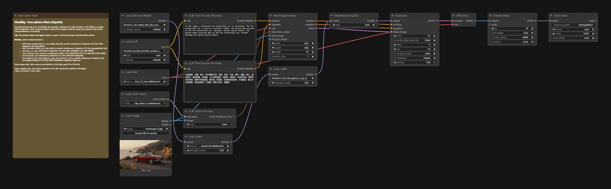

# One-photo effect

One photo becomes a 5 s effect clip, the format of the viral one-photo effects. Here Squish on the red convertible of the showcase: hands press the subject flat like soft clay. The effect is a Remade-AI LoRA on Wan 2.1 I2V 480p, run in 4 steps with the lightx2v distillation LoRA.

## Run it in ComfyUI

1. ComfyUI v0.41.0 or newer. Montagio starts it with `--disable-partner-nodes`: nothing in this graph needs a partner node or an API key.
2. Custom nodes: none, core ComfyUI nodes only.
3. Put the model files below under `ComfyUI/models/` (25.8 GB in all).
4. Drag [`workflows/montagio-one-photo-effect.json`](workflows/montagio-one-photo-effect.json) onto the canvas, load your inputs (see the node map), then run it. The note in the graph repeats the model list.

## Models

| File | Put under `ComfyUI/models/` | Size | License, source |
|---|---|---|---|
| `wan2.1_i2v_480p_14B_fp8_scaled.safetensors` | `diffusion_models/` | 16.4 GB | Apache-2.0, [Wan-AI/Wan2.1-I2V-14B-480P](https://huggingface.co/Wan-AI/Wan2.1-I2V-14B-480P) |
| `umt5_xxl_fp8_e4m3fn_scaled.safetensors` | `text_encoders/` | 6.7 GB | Apache-2.0, [google/umt5-xxl](https://huggingface.co/google/umt5-xxl) |
| `wan_2.1_vae.safetensors` | `vae/` | 0.3 GB | Apache-2.0, [Wan-AI/Wan2.1-I2V-14B-480P](https://huggingface.co/Wan-AI/Wan2.1-I2V-14B-480P) |
| `clip_vision_h.safetensors` | `clip_vision/` | 1.3 GB | MIT, [laion/CLIP-ViT-H-14-laion2B-s32B-b79K](https://huggingface.co/laion/CLIP-ViT-H-14-laion2B-s32B-b79K) |
| `squish_18.safetensors` | `loras/` | 0.4 GB | Apache-2.0, [Remade-AI/Squish](https://huggingface.co/Remade-AI/Squish) |
| `Wan21_I2V_14B_lightx2v_cfg_step_distill_lora_rank64.safetensors` | `loras/` | 0.7 GB | Apache-2.0, [lightx2v/Wan2.1-I2V-14B-480P-StepDistill-CfgDistill-Lightx2v](https://huggingface.co/lightx2v/Wan2.1-I2V-14B-480P-StepDistill-CfgDistill-Lightx2v) |

The download URLs and sha256 of every file are in [`registry/models.lock.yaml`](../registry/models.lock.yaml). Each license was read at the source repository, not at the mirror: see [`tools/check-open-stack/allowed-sources.yaml`](../tools/check-open-stack/allowed-sources.yaml).

## Comfy workflow

| Node | Type | What to set |
|---|---|---|
| `52` | Load Image | the photo |
| `6` | CLIP Text Encode | the effect's template, with its trigger words and what the photo shows |
| `200` | Load LoRA | the effect LoRA (see the table below) |
| `201` | Load LoRA | the 4-step lightx2v LoRA; bypass it and set 20 steps and cfg 6 on node `3` for the full-quality path |
| `3` | KSampler | `seed`; 4 steps, cfg 1 |
| `56` | Save Video | the clip |

The node ids are those of the API workflow the Montagio app compiles, so this graph and the app's jobs match node for node. To keep a change, save the graph from ComfyUI (this format), or export it as API JSON for a script.

The six effects of the pack, all validated on a GPU on 2026-10-21. Swap the LoRA of node `200` and the trigger in the text of node `6`:

| Effect | LoRA file (`loras/`) | Trigger | Source |
|---|---|---|---|
| Squish | `squish_18.safetensors` | `sq41sh squish effect` | [Remade-AI/Squish](https://huggingface.co/Remade-AI/Squish) |
| Cake-ify | `cakeify_16_epochs.safetensors` | `c4k3 cakeify it` | [Remade-AI/Cakeify](https://huggingface.co/Remade-AI/Cakeify) |
| Explode | `explode_30_epochs.safetensors` | `3xp105ion huge explosion` | [Remade-AI/Explode](https://huggingface.co/Remade-AI/Explode) |
| Snap Zoom | `crash_zoom_in.safetensors` | `cr34sh crash zoom in effect` | [Remade-AI/Crash-zoom-in](https://huggingface.co/Remade-AI/Crash-zoom-in) |
| Frozen Moment | `matrix_shot.safetensors` | `b4ll3t t1m3 bullet time shot` | [Remade-AI/matrix-shot](https://huggingface.co/Remade-AI/matrix-shot) |
| Full Circle | `360_Orbit.safetensors` | `0rb4it 360 degree orbit` | [Remade-AI/360-Orbit](https://huggingface.co/Remade-AI/360-Orbit) |

Each effect's full prompt template is in [`presets/effects/`](../presets/effects).

## Measured

On an NVIDIA L4 with 24 GB of VRAM, the memory of an RTX 4090 (which is about twice as fast). 4 steps: 156 s warm, peak 21 to 22.6 GB. All six effects were checked on a person, a dog and a car: each reads in the first second, with no `lora key not loaded` warning. Every measure, with its date: [`docs/BUILD_NOTES.md`](../docs/BUILD_NOTES.md#measured-on-a-gpu).

## Example

[`demo-assets/showcase/samples/landscape-b.jpg`](../demo-assets/showcase/samples/landscape-b.jpg) (Z-Image-Turbo). Previews of the six effects: [`presets/effects/previews/`](../presets/effects/previews).

## Limits

- 480p, 16 fps, 5 s.
- Avoid Cake-ify on a face: the knife lands on it.
- The Remade-AI LoRAs declare Apache-2.0 in their card metadata only, with no LICENSE file and no stated training data: Montagio accepts them and says so.

## License

The graph is converted, like every Montagio workflow but the voice's, from the official [Comfy-Org workflow templates](https://github.com/Comfy-Org/workflow_templates) (MIT, [license text](../workflows/LICENSE.workflow_templates)). Every model file is Apache-2.0 or MIT.
