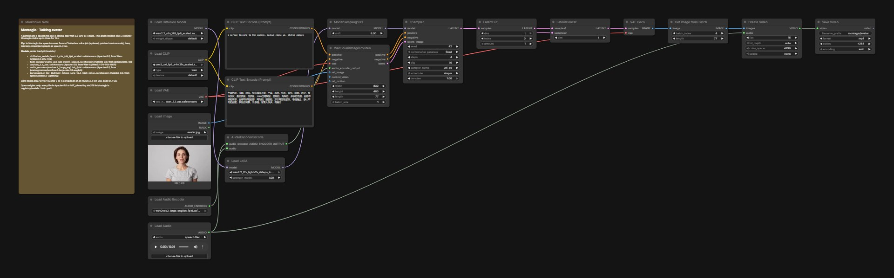

# Talking avatar

A portrait and a speech file give a talking clip: Wan 2.2 S2V in 4 steps with the lightx2v LoRA. The video follows the photo's identity, and the mouth follows the speech.

## Run it in ComfyUI

1. ComfyUI v0.41.0 or newer. Montagio starts it with `--disable-partner-nodes`: nothing in this graph needs a partner node or an API key.
2. Custom nodes: none for this graph. In Montagio the speech comes from a voice job on Chatterbox Multilingual (MIT), through a pinned custom node patched to remove its HTTP routes ([`workflows/chatterbox-mtl-voice.api.json`](../workflows/chatterbox-mtl-voice.api.json), installed by [`infra/runpod/bootstrap.sh`](../infra/runpod/bootstrap.sh)). Here, load any speech you have the right to use.
3. Put the model files below under `ComfyUI/models/` (25.2 GB in all).
4. Drag [`workflows/montagio-talking-avatar.json`](workflows/montagio-talking-avatar.json) onto the canvas, load your inputs (see the node map), then run it. The note in the graph repeats the model list.

## Models

| File | Put under `ComfyUI/models/` | Size | License, source |
|---|---|---|---|
| `wan2.2_s2v_14B_fp8_scaled.safetensors` | `diffusion_models/` | 16.4 GB | Apache-2.0, [Wan-AI/Wan2.2-S2V-14B](https://huggingface.co/Wan-AI/Wan2.2-S2V-14B) |
| `umt5_xxl_fp8_e4m3fn_scaled.safetensors` | `text_encoders/` | 6.7 GB | Apache-2.0, [google/umt5-xxl](https://huggingface.co/google/umt5-xxl) |
| `wan_2.1_vae.safetensors` | `vae/` | 0.3 GB | Apache-2.0, [Wan-AI/Wan2.1-I2V-14B-480P](https://huggingface.co/Wan-AI/Wan2.1-I2V-14B-480P) |
| `wav2vec2_large_english_fp16.safetensors` | `audio_encoders/` | 0.6 GB | Apache-2.0, [jonatasgrosman/wav2vec2-large-xlsr-53-english](https://huggingface.co/jonatasgrosman/wav2vec2-large-xlsr-53-english) |
| `wan2.2_t2v_lightx2v_4steps_lora_v1.1_high_noise.safetensors` | `loras/` | 1.2 GB | Apache-2.0, [lightx2v/Wan2.2-Lightning](https://huggingface.co/lightx2v/Wan2.2-Lightning) |

The download URLs and sha256 of every file are in [`registry/models.lock.yaml`](../registry/models.lock.yaml). Each license was read at the source repository, not at the mirror: see [`tools/check-open-stack/allowed-sources.yaml`](../tools/check-open-stack/allowed-sources.yaml).

## Comfy workflow

| Node | Type | What to set |
|---|---|---|
| `52` | Load Image | the portrait |
| `58` | Load Audio | the speech, up to 5 s for this one chunk |
| `6` | CLIP Text Encode | the scene |
| `3` | KSampler | `seed`; 4 steps, cfg 1, uni_pc |
| `113` | Save Video | the clip, with the speech |

The node ids are those of the API workflow the Montagio app compiles, so this graph and the app's jobs match node for node, except that node `113` saves under `montagio/avatar`, where the app's job saves under `montagio/avatar`. To keep a change, save the graph from ComfyUI (this format), or export it as API JSON for a script.

## Measured

On an NVIDIA L4 with 24 GB of VRAM, the memory of an RTX 4090 (which is about twice as fast). 127 to 145 s for 3 to 4 s of speech, peak 21.7 GB. The voice job before it: 2.5 to 5 s warm, 3.3 GB. Every measure, with its date: [`docs/BUILD_NOTES.md`](../docs/BUILD_NOTES.md#measured-on-a-gpu).

## Example

[`presets/extensions/previews/avatar.mp4`](../presets/extensions/previews/avatar.mp4), a clip of GPU session S2 (a fictional portrait made by Z-Image-Turbo).

## Limits

- One chunk of 77 frames covers 5 s of speech at 16 fps; Montagio chains up to three for 15 s, each extension reading the latent made so far.
- The video is conditioned by the photo's identity: it does not start on its pixels.
- Chatterbox's built-in voice is male whatever the face; Montagio takes a consented voice sample instead.

## License

The graph is converted from the official [Comfy-Org workflow templates](https://github.com/Comfy-Org/workflow_templates) (MIT, [license text](../workflows/LICENSE.workflow_templates)), like most Montagio workflows; the five with no template (the voice, the voice change, the translation, the captions and the trend post) are written for Montagio ([`workflows/README.md`](../workflows/README.md#extension-workflows)). Every model file is Apache-2.0 or MIT.
