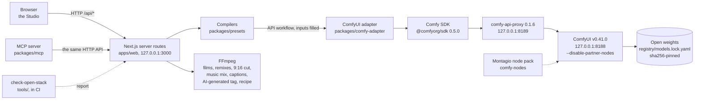

# Montagio build notes

How Montagio is built on the Comfy Developer Platform: the architecture, the path of a request, the workflows each feature runs, every time and VRAM measured on a GPU, and the design choices behind them. The ComfyUI graphs themselves, ready to load, are in [`comfy-hub/`](../comfy-hub/README.md); installing Montagio is in [INSTALL.md](INSTALL.md).

## On the Comfy Developer Platform

Montagio is built with the **Comfy SDK** ([`@comfyorg/sdk`](https://github.com/Comfy-Org/comfy-typescript-sdk) 0.5.0, MIT) against a **local ComfyUI** v0.41.0, through **[comfy-api-proxy](https://github.com/Comfy-Org/comfy-api-proxy)** 0.1.6 (MIT), which serves the Comfy API in front of it on `127.0.0.1`. That is the platform's self-hosted path: the same SDK calls that reach Comfy Cloud, pointed at a machine you own. Montagio uses neither the Router nor any partner node, so every model in the render path is open weights, and no account, key or credit is involved.

## Architecture

| Part | Where | Role |
|---|---|---|
| Studio | [`apps/web`](../apps/web) | the pages (Explore, the Studio tabs, Characters, Ads, Voice change, Translate, Trend remix, Community, History, Open Stack) and the server routes that own every job |
| Registry | [`registry/`](../registry), [`packages/registry`](../packages/registry) | the models, their workflows and bindings (which node and field takes the image, the prompt, the seed…), the ten extensions and their GPU validation dates, the 12 GB profile, the weight lock |
| Compilers | [`packages/presets`](../packages/presets) | a preset or a request in, an API workflow out, every value checked before anything reaches the GPU |
| Adapter | [`packages/comfy-adapter`](../packages/comfy-adapter) | the only code that talks to ComfyUI, through the SDK |
| Assembly | [`packages/sequence`](../packages/sequence) | FFmpeg: films from shots, a trend's shots put back on its frames, the 9:16 cut, the music mix, the "AI-generated" tag and the compact recipe in every output |
| Captions | [`packages/captions`](../packages/captions) | the words Whisper heard, aligned with the text a user corrects, and the ASS script of the five caption styles |
| Recipes | [`packages/recipe`](../packages/recipe) | the recipe of a result: what made it, by sha256, and what renders it again |
| Node pack | [`comfy-nodes`](../comfy-nodes/README.md) | Montagio Camera Embedding, the preset loaders, Montagio Transcribe Words |
| MCP server | [`packages/mcp`](../packages/mcp/README.md) | 20 tools over the app's HTTP API, `reproduce` included |
| Installer | [`infra/local`](../infra/local) | ComfyUI, comfy-api-proxy, PyTorch, the node packs, the weights, yt-dlp and the app, in one command |
| GPU sessions | [`infra/runpod`](../infra/runpod/README.md), [`infra/modal`](../infra/modal/README.md) | the same install on a rented GPU, and the smoke runs that measured everything below |
| Open-stack check | [`tools/check-open-stack`](../tools/check-open-stack) | the proof, on every commit, that the stack stays open |

## The path of a request

A camera clip, from the Generate button to the file:

1. The Studio posts the photo's id, the preset, the model and the text of what the photo shows to `/api/generations`, with an idempotency key.
2. The route validates the request and loads the preset (YAML, schema-checked) and the model's registry entry.
3. `compileJob` fills the model's API workflow, a file of [`workflows/`](../workflows/README.md), at the nodes its bindings name: image, prompt, negative, seed, size, frames, fps and the camera move. A preset with two moves switches the camera node to Montagio Camera Embedding.
4. The adapter builds the job with the SDK: `client.workflows.fromJson(workflow)`, `workflow.setInput(node, field, client.assets.fromFile(path))` for the photo, then `client.submit(workflow)`. The SDK client is created with an explicit local base URL and a `fetch` that refuses any other origin; a Comfy-hosted host is refused outright.
5. The Studio polls `/api/generations/{id}`; the server reads `client.jobs.get(id)` and passes on its status and progress.
6. When the job succeeds, the adapter picks the output by kind and node, downloads it from the proxy and keeps it under `data/`. FFmpeg writes the "AI-generated" mention into the file's metadata before the Studio shows it.
7. When the result is delivered, its recipe is written beside it: the workflow and its sha256, the weight files with their lock sha256, the seed, the settings and the sha256 of each input. A compact copy goes into the MP4 (its `synopsis` tag) or the PNG, and Reproduce sends the same request again ([INSTALL.md](INSTALL.md#reproduce-a-recipe)).
8. "Open in ComfyUI" downloads the exact API workflow that ran.

Every other feature follows the same path through its own route and compiler. The ones that chain models run their jobs one after the other, each on the output of the one before: a hook (edit, then transition), an avatar (voice, then talking video), a translation (Gemma and the voice, then the talking video), an ad (scene, effect, music), a composed character (edit, then motion), a restyle (edit of the first frame, then VACE), a trend remix (one job per remade shot, then the assembly).

## The workflows each feature runs

The workflows are converted from the official [Comfy-Org workflow templates](https://github.com/Comfy-Org/workflow_templates) at commit `59a3b48b` (MIT), except five written for Montagio where no template exists: the voice, the voice change, the translation, the captions and the trend skeleton. The changes from each template are listed in [`workflows/README.md`](../workflows/README.md).

| Feature | Workflow(s) | Model (license) |
|---|---|---|
| Camera, Quality | `wan22-fun-camera.api.json` (20 steps) | Wan 2.2 Fun Camera 14B (Apache-2.0), with Montagio Camera Embedding for two moves |
| Camera, Turbo | `wan22-fun-camera-turbo.api.json` (the template's 4-step group) | the same, with the lightx2v Wan 2.2 I2V 4-step LoRAs (Apache-2.0) |
| Camera, Fast | `wan22-ti2v-5b.api.json` | Wan 2.2 TI2V 5B (Apache-2.0); the move goes into the prompt |
| Film | the camera workflows, one shot after the other, each from the last frame of the one before | as above |
| Text to image, a character's portrait, the 28 faces | `z-image-turbo.api.json` | Z-Image-Turbo (Apache-2.0) |
| Photo edit, looks, relight, palettes, inpaint, drawing to photo, photodump, compositions, ad scene, a hook's end frame, a restyle's first frame | `qwen-image-edit-2511.api.json` | Qwen-Image-Edit-2511 with a 4-step Lightning LoRA (Apache-2.0) |
| One-photo effects | `wan21-i2v-effect.api.json` | Wan 2.1 I2V 480p (Apache-2.0) and a Remade-AI LoRA (Apache-2.0) |
| Hooks | the edit, then `wan22-flf2v-transition.api.json` | Wan 2.2 I2V A14B as first-last frame (Apache-2.0) |
| Talking avatar | `chatterbox-mtl-voice.api.json`, then `wan22-s2v-avatar.api.json` | Chatterbox Multilingual (MIT), Wan 2.2 S2V (Apache-2.0) |
| Voice change | `chatterbox-vc.api.json` | Chatterbox VC (MIT) |
| Translation and lip-sync | `translate-speech.api.json` (Gemma transcribes, then translates; Chatterbox speaks in the source's voice), then `wan22-s2v-avatar.api.json` | Gemma 4 E4B (Apache-2.0), Chatterbox Multilingual (MIT), Wan 2.2 S2V |
| Captions 9:16 of a talking clip | `whisper-words.api.json` (`LoadAudio`, the pack's Montagio Transcribe Words, the core `SaveText`), then FFmpeg and libass burn the words in | Whisper large-v3 turbo (MIT) |
| Music | `ace-step15-music.api.json` | ACE-Step 1.5 (MIT) |
| HD 1080p, smooth motion | `seedvr2-upscale.api.json` (the template, then RIFE in core nodes) | SeedVR2 3B (Apache-2.0), RIFE 4.26 (MIT) |
| HD photo | `seedvr2-image-upscale.api.json` | SeedVR2 3B (Apache-2.0) |
| Motion transfer, up to 30 s | `wan-animate2-motion.api.json`, with the core context windows past 81 frames | Wan2.2-Animate-2, distilled (Apache-2.0) |
| Restyle | the edit of the first frame (or a look image), then `wan21-vace-restyle.api.json`, guided by the depth of each frame | Wan 2.1 VACE 14B with a 4-step lightx2v T2V LoRA, Depth Anything 3 Small (Apache-2.0) |
| Object swap | `wan21-vace-swap.api.json`: SAM 2.1 follows the painted object, VACE redraws it | SAM 2.1 base+ fp16 through the pinned SAM 2 pack, Wan 2.1 VACE 14B (Apache-2.0) |
| Ad studio | the edit (the scene), an effect, the music, then an FFmpeg overlay of the tagline | as above |
| Trend remix | `gemma-trend-skeleton.api.json` for the post, then the motion transfer or the object swap per shot, on one seed, then FFmpeg | Gemma 4 E4B, Wan2.2-Animate-2 or VACE |

19 models and 65 entries in the weight lock (40 Apache-2.0, 25 MIT, 254 GB), each listed with its size and source on the app's Open Stack page. One image encoder serves two extensions; Whisper's 11 entries are its weights and its configuration and tokenizer files.

## Measured on a GPU

Every render below ran on an NVIDIA **L4 with 24 GB of VRAM**, the memory of the RTX 4090 that Montagio targets, rented on Modal. An RTX 4090 is about twice as fast: the official templates state 536 s for Fun Camera on an RTX 4090D against 1,134 s here, and 71 s for FLF2V against 134 to 157 s. The registry's time estimates are mostly these measures halved; the 12 GB profile's and Whisper's are kept as measured on the L4, and the translation's and the trend skeleton's were written before their GPU runs. The reports, with every verdict, are in [S2_RESULTATS.md](S2_RESULTATS.md) (in French).

**GPU session S2, 2026-10-21.** The first renders of the project, 480p unless stated.

| Job | Time on the L4 | Peak VRAM |
|---|---|---|
| Camera preset, Fun Camera 14B, 5 s, 20 steps | 1,158 s cold, 1,133 s warm; 1,110 to 1,170 s across the presets | 18 to 21 GB |
| Camera preset, Fun Camera 14B, 720p | 4,331 s | 21.5 GB |
| Fast mode, Wan 2.2 5B, 121 frames at 24 fps | 190 s cold; 508 s at 720p | 21.2 GB |
| Text to image, Z-Image-Turbo | 9.1 to 9.6 s warm, 45 s cold | 20.4 to 22.3 GB |
| Photo edit, Qwen-Image-Edit-2511, 4 steps | 20 to 25 s warm, 71 s cold; 306 s in 40 steps | 21.5 to 22.6 GB |
| One-photo effect, 4 steps | 156 s warm | 21 to 22.6 GB |
| Hook transition, FLF2V, 4 steps | 134 to 157 s; 1,084 s in 20 steps | — |
| Voice, Chatterbox | 14 s cold, 2.5 to 5 s warm | 3.3 GB |
| Talking avatar, S2V, 3 to 4 s of speech | 127 to 145 s | 21.7 GB |
| Music, ACE-Step 1.5 | 60 s of music in 9.5 s warm; 10 s in 32 s cold | 10 to 14.6 GB |
| HD upscale, SeedVR2 3B, 81 frames to 1080p | 428 s | 18.4 GB |
| Motion transfer, Animate-2 distilled, 5 s | 391 to 415 s | 20.1 to 22.2 GB |

At install: torch 2.14.1 (CUDA 13.0), **687 node classes loaded and 0 partner nodes**, the Montagio pack's heavy test 270/270, and the 45 weights of the lock at the time downloaded and checked against their sha256, with no failure. The session cost $12.94.

**Characters, relight, inpaint, HD photo, voice sample, 2026-10-22** (six jobs in one container, about $0.10):

| Job | Time on the L4 | Peak VRAM |
|---|---|---|
| Character portrait, Z-Image-Turbo, 9:16 | 39 s cold | 20.3 GB |
| Photodump picture (the edit: the character in a café) | 65 s cold | 22.2 GB |
| Relight "neon night" | 20 s | 22.6 GB |
| Inpaint of the sky (painted mask) | 20 s | 22.6 GB |
| HD photo, SeedVR2, to 1440×2560 | 14 s, loading included | 19.9 GB |
| Voice from a sample (pitch 222 Hz against 131 Hz for the built-in voice) | 14 s | 7.2 GB |

**Composition, ad, drawing, voice change, 2026-10-22** (five jobs in one container, 8 min 24 s, about $0.17; the voice change from a retake, about $0.08):

| Job | Time on the L4 | Peak VRAM |
|---|---|---|
| Ad scene, Lifestyle style (the edit) | 78 s cold | 22.2 GB |
| Drawing to photo (the edit) | 21 s | 22.5 GB |
| Composition from three references (place, character, product) | 46 s | 22.4 GB |
| Snap Zoom on the composed photo | 182 s | 22.4 GB |
| Ad music, ACE-Step, 10 s | 33 s | 22.3 GB |
| Voice change, Chatterbox VC (3.92 s kept) | 23.6 s cold, loading included | 4.3 GB |

**Smooth HD, 2026-10-24** (one job, about $0.15):

| Job | Time on the L4 | Peak VRAM |
|---|---|---|
| HD 1080p then RIFE 4.26 ×2: 81 frames at 16 fps to 161 at 32 fps | 410 s cold, loading included; RIFE alone 4.8 s | 8.6 GB |

**Species, palettes, moodboard, translation, lip-sync, 2026-10-24** (five jobs in one container, about $0.25 with Gemma's download):

| Job | Time on the L4 | Peak VRAM | Verdict |
|---|---|---|---|
| 12 species portraits, Z-Image-Turbo, 9:16 | 49 s for the first, then 9 s each | 21.1 to 22.3 GB | 11 of 12 good; the person's prompt now asks for a modest outfit |
| Ready-made palette "teal and orange" (the edit) | 21 s | 22.6 GB | framing kept, colours changed |
| Moodboard (an edit after a board of two images) | 85 s cold | 22.4 GB | failed: the tones of the board did not carry over; hidden |
| Palette from a photo (the edit, second image) | 33 s | 22.6 GB | failed: the content of the second photo was copied; hidden |
| Translation, one pass (Gemma 4, then Chatterbox) | 49 s cold | 20.2 GB | failed: Gemma gave the transcription, not the translation |
| Lip-sync: S2V on the produced speech | 284 s cold | 22.2 GB | the lips follow the speech |

The translation was redone in two passes on 2026-10-25 (Gemma transcribes, then translates the text): 43 s cold, 11.0 GB, about $0.06, the speech heard back in Spanish.

**Restyle, 2026-10-24** (a spike on two L4s, then the wired path; $0.80 in all):

| Job | Time on the L4 | Peak VRAM | Verdict |
|---|---|---|---|
| Edit of the first frame | 73 s cold | 22.2 GB | |
| Restyle from that first frame | 239 s, VACE loading included | 22.5 GB | the scene restyled, the push followed frame by frame |
| Restyle from the text alone ("a watercolor painting…") | 186 s | 22.3 GB | the scene rebuilt and the move followed, but realistic, not watercolour |
| Restyle after a look image | 196 s | 22.2 GB | the dancer becomes the character, poses and push exact |

The spike compared Canny edges and depth as the control; the wiring keeps depth (Depth Anything 3 Small).

**Motion transfer 30 s, Motion library, composed character, 2026-10-24; object swap, 2026-10-25** (eight apps for $5.15, of which $1.70 for the 30 s series; then four for $0.27):

| Job | Time on the L4 | Peak VRAM | Verdict |
|---|---|---|---|
| A Motion library clip (Wan 2.1 I2V 480p, a fictional character) | 154 s per clip | — | seven moves, including a 30 s dance in six clips |
| Motion transfer, 30 s (481 frames, 9 context windows) | 3,425 s | 22.6 GB | the same character from start to end |
| Composed character (character, outfit, product), then its motion, 5 s | 82 to 84 s, then 425 s | 22.2 GB, 22.6 GB | kept once the product comes before the outfit in the edit's images |
| Object swap from a text (SAM 2.1, then VACE), 81 frames | 252 s, VACE loading included | 21.0 GB | the object followed and redrawn |
| Object swap from a photo of the new object, 80 frames | 207 s | 22.5 GB | |

SAM 2.1 in fp32 found no kernel on the L4 ("No available kernel"); the lock and the workflow take its fp16 file. On a laptop CPU, the same tracking of 17 frames took 314 s.

**Turbo and the 12 GB profile, 2026-10-25** (about $0.90 for both):

| Job | Time on the L4 | Peak VRAM | Verdict |
|---|---|---|---|
| Turbo, Fun Camera 14B, 4 steps, 13 clips | 156 s cold, then 136 to 138 s per clip (8.3 times faster than 20 steps) | 22.4 GB (dynamic VRAM fills the card) | 11 of 13 kept the move; Pan Left ghosted a person, Rise & Push lost the car |
| 12 GB profile: Turbo, Crash Push | 153.5 s (156.2 s at 24 GB) | 11.46 GiB | the same move |
| 12 GB profile: effect Squish | 174 s (175 to 184 s at 24 GB) | 11.29 GiB | |
| 12 GB profile: Fast (5B) | 192.9 s (190 s) | 11.26 GiB | |
| 12 GB profile: text to image, 1280×720 | 48 s (45 s) | 11.27 GiB | |

The 12 GB profile ran on the same L4 with `infra/modal/vram_cap.py` holding all but 11.5 GiB of VRAM and the container limited to 32 GiB of RAM, with the same fp8 weights: ComfyUI's dynamic VRAM moves the part of a model that does not fit between two steps.

**Character bank, trend remix, captions, 2026-10-25:**

| Job | Time on the L4 | Peak VRAM | Cost |
|---|---|---|---|
| 28 faces, Z-Image-Turbo, 720p 9:16 | 45.9 s for the first, then 8.6 to 9.3 s | 20.5 to 22.3 GB | $0.13 (five redone) |
| Trend remix, first shot of 2 s (Animate-2, 33 frames) | 166 s, loading included | 21.9 GB | $0.23 in all |
| Trend remix, second and third shots | 125 s each | 21.5 to 21.8 GB | |
| Trend skeleton and post (Gemma 4 E4B, a sheet of three first frames) | 22.8 s | 7.9 GB | |
| Captions, 2.9 s of speech (Whisper large-v3 turbo) | 10.5 s, model loading included | 4.9 GB | $0.016 |

On a laptop CPU, Whisper heard the same 2.9 s in 95.7 s (fp32), with the same words and moments.

**The showcase**, 2026-10-24: 43 clips in 1080p, the 11 presets on 3 photos, 9 effect examples and the Ignite hook. Each was rendered at 480p (the 33 camera clips in 20 steps, the effects and the hook in 4) with the description of its photo (15 camera clips again that day, from the exact sample photos), then passed through SeedVR2; the showcase's manifest records the whole chain, photo, 480p render and HD pass, for every clip ([VITRINE.md](VITRINE.md), part 7, in French).

How the times were taken: `smoke.ts` ([`infra/runpod`](../infra/runpod/README.md)) compiles each job with the app's own compilers, submits it through comfy-api-proxy and writes one line per run (`smoke.jsonl`) with its wall time, its execution time and the peak VRAM (from `nvidia-smi`, or ComfyUI's `/system_stats`). "Cold" includes loading the weights from the volume; "warm" is a later run with the models in memory.

## Design choices

- **Local first, through the SDK.** The Comfy SDK talks to a self-hosted comfy-api-proxy, so the app gets the Comfy API's jobs, assets and outputs without sending a photo anywhere. The SDK would fall back to Comfy Cloud on a blank base URL: the adapter refuses a blank or Comfy-hosted URL, and its `fetch` refuses any other origin.
- **A local API that stays local.** The services listen on `127.0.0.1`; the app answers its API only under a loopback host name on its own port (or one listed in `MONTAGIO_ALLOWED_HOSTS`), refuses requests sent from another site, and asks an idempotency key for every job. A web page elsewhere cannot drive it through the browser.
- **Open weights, read at the source.** A weight enters the lock only under Apache-2.0 or MIT with no added condition, read on the source repository rather than on the mirror. Some official templates download files from repositories that fail that rule: the Qwen-Image-Edit text encoder from a mirror whose card carries a territory-restricted license, lightx2v LoRAs from a repository with no declared license. The lock takes the encoder's same bytes from an Apache-2.0 mirror and the LoRAs from lightx2v's own repositories, and `check-open-stack` refuses the two repositories by name.
- **Official templates, converted, not reinvented.** Every workflow starts from a Comfy-Org template where one exists, keeps its node ids and lists each change. The registry names the nodes and fields a request fills; the compiler touches nothing else.
- **Core nodes, with three exceptions.** Montagio's own pack holds Montagio Camera Embedding, because the core camera node takes a single move, and Montagio Transcribe Words, because core ComfyUI has no speech-to-text node. Two third-party packs are pinned to a commit: the voice node, patched to remove its HTTP routes, because core ComfyUI has no local speech node; and the SAM 2 tracker for the object swap, unchanged. Everything else, RIFE and the context windows included, is core.
- **Presets are files.** A camera move, an effect or a hook is a YAML file under CC-BY-4.0, checked against a schema. The same file runs in the Studio, in the remix editor and in a ComfyUI graph through the node pack, and tests compare the pack's values with the app's.
- **HD through the upscale.** 480p followed by SeedVR2 gives 1080p about three times faster than a native 720p render, so the Studio renders 480p and offers "HD 1080p". Smooth motion is an option of that pass, not a model of its own: RIFE takes 4.8 s of the 410.
- **4 steps by default, 20 where they matter.** The edit, the effects, the hooks, the avatar, Restyle and the object swap run their distillation LoRAs (4 steps); the edit, the effects and the hooks keep a full-step path (`fast: false`). On the camera, Turbo keeps the move because the camera path, not the step count, drives it: it is the default of the seven presets that push, pull or rise, and Quality stays the default of Rise & Push, where Turbo lost the subject, and of the three sideways moves, since Turbo ghosted a person on Pan Left.
- **12 GB through dynamic VRAM, not new weights.** The fp8 files of the lock already run within 11.5 GiB with ComfyUI's dynamic VRAM, so the 12 GB profile adds no GGUF file and no node pack. It offers only what a render within 12 GB validated, with the times measured there.
- **The description of the photo is required.** S2 changed one variable per clip on the same photo and seed: the text of what the photo shows alone removed the ghosting. The Studio fills it in whenever the photo's text is known.
- **Every result is reproducible.** A result carries its recipe, written when it is delivered, so a later preset, lock or Montagio version never changes what made it. Same recipe and same stack give the same result on the same setup, and a very close one elsewhere: diffusion is not always bit-exact from one graphics card to another. A recipe holds the sha256 of each input, never the input, never a path, never a link.
- **Two passes for a translation.** Asked to transcribe and translate at once, Gemma gave the transcription. The workflow asks for the transcription alone, then for the translation of that text, with the instruction first.
- **Restyle guided by depth.** The control of every frame is its depth (Depth Anything 3 Small), kept after the spike compared it with Canny edges. A style asked in words alone stayed realistic, so by default the edit restyles the first frame first, or the user gives an image to follow.
- **A trend remix keeps one character.** Every remade shot runs on the same references and the same seed, and the shots go back on the trend's own frames at its frame rate. The trend's sound is left out unless the user keeps it and confirms the right to, and its link import runs only on the user's machine, never in the demo mode or the showcase.
- **Captions burned in by FFmpeg, drawn as ASS.**
  - Word-by-word captions are an ASS script that libass renders inside FFmpeg, on the server, into a 1080x1920 frame.
  - The script holds five styles: karaoke `\kf` sweep, pop, one word, boxed, neon. Their sizes, colours, line breaks and transitions come from RushGlide, a subtitle engine by the same author.
  - The same chain draws the Studio's preview frame, so the preview is the export.
  - A browser renderer (Canvas and WebCodecs) would have kept the original drawing code. It would also tie the export to an open tab, and a recipe could not replay it.
  - The fonts (OFL) are embedded and copied next to the script, so FFmpeg names no Windows path in its filter graph.
- **Whisper inside ComfyUI, and optional.**
  - The transcription is a ComfyUI job like the others, so its weights are in the lock and its recipe names them. Its node runs on `transformers`, which ComfyUI already needs.
  - A ComfyUI without it hides the captions alone, never the avatar, the voice change or the translation. The trend skeleton (Gemma) is optional the same way: without it, the post is typed.
  - The text a user corrects keeps Whisper's moments: words are aligned like a diff (Levenshtein), and a merged word ("Shot Rate" to "Montagio") takes the time of both.
- **Shown only when validated.** An extension, an effect or a hook appears in the Studio only once a GPU session has dated it (`gpu_validated`). Iris Dive and Figurine stay hidden, and the moodboard and the palette from a photo stay behind `MONTAGIO_EXPERIMENTAL`: the moodboard lost the tones of its board, and the palette from a photo copied the photo's content.
- **Guardrails and a text filter.** A consent box before a person's photo is edited, animated or made to speak, a consented sample for any voice but the built-in one, the agreement of the person shown for a translation, rights boxes for every video, well-known names and explicit sexual terms refused in texts, characters that are always fictional, and the "AI-generated" mention in every file. The explicit-term filter is on by default; `MONTAGIO_CONTENT_FILTER=off` disables only that filter on a local backend. Both text lists are good-faith guardrails, not complete moderation.
- **A pinned install.** One ComfyUI commit, one PyTorch build per CUDA version, every weight by sha256, every node pack at a commit, the yt-dlp binary by sha256, every service on `127.0.0.1`. The installer does not use comfy-cli, which brings telemetry SDKs and ComfyUI-Manager.
- **GPU sessions on included compute.** The renders ran on a 24 GB L4, the same memory as the target card, within Modal's monthly compute credit; one long render per container, since a preemption restarts the whole container.

## Licenses

| Part | License |
|---|---|
| App and server | AGPL-3.0-only |
| Libraries, tools, installer, GPU tooling | Apache-2.0 |
| Montagio node pack | GPL-3.0-only |
| Presets | CC-BY-4.0 |
| Workflows | converted from the Comfy-Org templates, MIT ([license text](../workflows/LICENSE.workflow_templates)), and five written for Montagio |
| Model weights | Apache-2.0 (40 lock entries) or MIT (24), listed with their sources in [`registry/models.lock.yaml`](../registry/models.lock.yaml) |
| Caption fonts | Poppins, Anton, Bebas Neue, Montserrat: SIL OFL 1.1, embedded with their licences ([`apps/web/public/fonts/captions`](../apps/web/public/fonts/captions/README.md)) |
| ComfyUI, the Comfy SDK, comfy-api-proxy | GPL-3.0, MIT, MIT: installed beside Montagio, never bundled |
| yt-dlp | Unlicense: the release binary, downloaded by the installer, never bundled |

## Known limits

- Clips are 5 s at 16 fps and 480p before the HD pass, except the motion transfer (up to 30 s), the avatar (up to 15 s), the trend remix (a trend of up to 60 s) and the Fast camera model (24 fps); films chain two or three clips.
- Fun Camera renders push-ins, pull-backs and side moves well, vertical moves and rolls poorly. In 4 steps, a sideways move can ghost a person.
- Motion transfer needs a photo framed like the reference video.
- Restyle and the object swap take the first 5 s of a clip.
- Gemma reads only the first frame of each shot of a trend, so a dance whose dancers stand still at the start reads as a still pose.
- Captions:
  - Captions are made in 22 languages written in the Latin alphabet. Japanese and Chinese would need CJK fonts and line breaks without spaces.
  - Films and ads have no voice to caption: their music is instrumental.
- The 12 GB profile offers Turbo, Fast, text to image and the effects only.
- The local installer installs the avatar's voice node and the object swap's SAM 2 node when those extensions are asked for; the voice node's packages exist for Python 3.12 only on Windows.
- The checks above prove each graph and measure each render; they are not a benchmark across GPUs.
