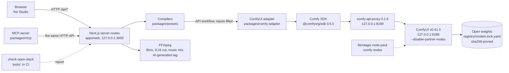

# Montagio build notes

How Montagio is built on the Comfy Developer Platform: the architecture, the path of a request, the workflows each feature runs, every time and VRAM measured on a GPU, and the design choices behind them. The ComfyUI graphs themselves, ready to load, are in [`comfy-hub/`](../comfy-hub/README.md); installing Montagio is in [INSTALL.md](INSTALL.md).

## On the Comfy Developer Platform

Montagio is built with the **Comfy SDK** ([`@comfyorg/sdk`](https://github.com/Comfy-Org/comfy-typescript-sdk) 0.5.0, MIT) against a **local ComfyUI** v0.41.0, through **[comfy-api-proxy](https://github.com/Comfy-Org/comfy-api-proxy)** 0.1.6 (MIT), which serves the Comfy API in front of it on `127.0.0.1`. That is the platform's self-hosted path: the same SDK calls that reach Comfy Cloud, pointed at a machine you own. Montagio uses neither the Router nor any partner node, so every model in the render path is open weights, and no account, key or credit is involved.

## Architecture

| Part | Where | Role |
|---|---|---|
| Studio | [`apps/web`](../apps/web) | the pages (Explore, the Studio tabs, Characters, Ads, Voice, History, Open Stack) and the server routes that own every job |
| Registry | [`registry/`](../registry), [`packages/registry`](../packages/registry) | the models, their workflows and bindings (which node and field takes the image, the prompt, the seed…), the extensions and their GPU validation dates, the weight lock |
| Compilers | [`packages/presets`](../packages/presets) | a preset or a request in, an API workflow out, every value checked before anything reaches the GPU |
| Adapter | [`packages/comfy-adapter`](../packages/comfy-adapter) | the only code that talks to ComfyUI, through the SDK |
| Assembly | [`packages/sequence`](../packages/sequence) | FFmpeg: films from shots, the 9:16 cut, the music mix, the "AI-generated" tag in every output |
| Node pack | [`comfy-nodes`](../comfy-nodes/README.md) | Montagio Camera Embedding and the preset loaders |
| Installer | [`infra/local`](../infra/local) | ComfyUI, comfy-api-proxy, PyTorch, the weights and the app, in one command |
| GPU sessions | [`infra/runpod`](../infra/runpod), [`infra/modal`](../infra/modal/README.md) | the same install on a rented GPU, and the smoke runs that measured everything below |
| Open-stack check | [`tools/check-open-stack`](../tools/check-open-stack) | the proof, on every commit, that the stack stays open |

## The path of a request

A camera clip, from the Generate button to the file:

1. The Studio posts the photo's id, the preset, the model and the text of what the photo shows to `/api/generations`, with an idempotency key.
2. The route validates the request and loads the preset (YAML, schema-checked) and the model's registry entry.
3. `compileJob` fills the model's API workflow, a file of [`workflows/`](../workflows/README.md), at the nodes its bindings name: image, prompt, negative, seed, size, frames, fps and the camera move. A preset with two moves switches the camera node to Montagio Camera Embedding.
4. The adapter builds the job with the SDK: `client.workflows.fromJson(workflow)`, `workflow.setInput(node, field, client.assets.fromFile(path))` for the photo, then `client.submit(workflow)`. The SDK client is created with an explicit local base URL and a `fetch` that refuses any other origin; a Comfy-hosted host is refused outright.
5. The Studio polls `/api/generations/{id}`; the server reads `client.jobs.get(id)` and passes on its status and progress.
6. When the job succeeds, the adapter picks the output by kind and node, downloads it from the proxy and keeps it under `data/`. FFmpeg writes the "AI-generated" mention into the file's metadata before the Studio shows it.
7. When the result is delivered, its recipe is written beside it: the workflow and its sha256, the weight files with their lock sha256, the seed, the settings and the sha256 of each input. A compact copy goes into the MP4 (its `synopsis` tag) or the PNG, and Reproduce sends the same request again ([INSTALL.md](INSTALL.md#reproduce-a-recipe)).
8. "Open in ComfyUI" downloads the exact API workflow that ran.

Every other feature follows the same path through its own route and compiler; the ones that chain models (a hook, an avatar, an ad) run their jobs one after the other, each on the output of the one before.

## The workflows each feature runs

Every workflow is converted from an official [Comfy-Org workflow template](https://github.com/Comfy-Org/workflow_templates) at commit `59a3b48b` (MIT), except the voice's two, which have no template because core ComfyUI has no local speech node. The changes from each template are listed in [`workflows/README.md`](../workflows/README.md).

| Feature | Workflow(s) | Model (license) |
|---|---|---|
| Camera, Quality | `wan22-fun-camera.api.json` | Wan 2.2 Fun Camera 14B (Apache-2.0), with Montagio Camera Embedding for two moves |
| Camera, Fast | `wan22-ti2v-5b.api.json` | Wan 2.2 TI2V 5B (Apache-2.0); the move goes into the prompt |
| Film | the camera workflows, one shot after the other, each from the last frame of the one before | as above |
| Text to image, a character's portrait | `z-image-turbo.api.json` | Z-Image-Turbo (Apache-2.0) |
| Photo edit, looks, relight, inpaint, composition, drawing to photo, photodump, ad scene, a hook's end frame | `qwen-image-edit-2511.api.json` | Qwen-Image-Edit-2511 with a 4-step Lightning LoRA (Apache-2.0) |
| One-photo effects | `wan21-i2v-effect.api.json` | Wan 2.1 I2V 480p (Apache-2.0) and a Remade-AI LoRA (Apache-2.0) |
| Hooks | the edit, then `wan22-flf2v-transition.api.json` | Wan 2.2 I2V A14B as first-last frame (Apache-2.0) |
| Talking avatar | `chatterbox-mtl-voice.api.json`, then `wan22-s2v-avatar.api.json` | Chatterbox Multilingual (MIT), Wan 2.2 S2V (Apache-2.0) |
| Voice change | `chatterbox-vc.api.json` | Chatterbox VC (MIT) |
| Music | `ace-step15-music.api.json` | ACE-Step 1.5 (MIT) |
| HD 1080p, smooth motion | `seedvr2-upscale.api.json` | SeedVR2 3B (Apache-2.0), RIFE 4.26 (MIT) |
| HD photo | `seedvr2-image-upscale.api.json` | SeedVR2 3B (Apache-2.0) |
| Motion transfer | `wan-animate2-motion.api.json` | Wan2.2-Animate-2, distilled (Apache-2.0) |
| Ad studio | the edit (the scene), an effect, the music, then an FFmpeg overlay of the tagline | as above |
| Captions 9:16 of a talking clip | `whisper-words.api.json` (`LoadAudio`, the pack's Montagio Transcribe Words, the core `SaveText`), then FFmpeg and libass burn the words in | Whisper large-v3 turbo (MIT) |

16 models and 60 entries in the weight lock, each listed with its size and source on the app's Open Stack page. One encoder serves two extensions; the 11 entries of Whisper are its weights and its configuration and tokenizer files.

## Measured on a GPU

Every render below ran on an NVIDIA **L4 with 24 GB of VRAM**, the memory of the RTX 4090 that Montagio targets, rented on Modal. An RTX 4090 is about twice as fast: the official templates state 536 s for Fun Camera on an RTX 4090D against 1,134 s here, and 71 s for FLF2V against 134 to 157 s. The registry's time estimates are these measures halved.

**GPU session S2, 2026-10-21** (report: [S2_RESULTATS.md](S2_RESULTATS.md), in French). The first renders of the project, 480p unless stated.

| Job | Time on the L4 | Peak VRAM |
|---|---|---|
| Camera preset, Fun Camera 14B, 5 s, 20 steps | 1,158 s cold, 1,133 s warm; 1,110 to 1,170 s across the presets | 18 to 21 GB |
| Camera preset, Fun Camera 14B, 720p | 4,331 s | 21.5 GB |
| Fast mode, Wan 2.2 5B, 121 frames at 24 fps | 190 s cold; 508 s at 720p | 21.2 GB |
| Text to image, Z-Image-Turbo | 9.1 to 9.6 s warm, 45 s cold | 20.4 to 22.3 GB |
| Photo edit, Qwen-Image-Edit-2511, 4 steps | 20 to 25 s warm, 71 s cold; 306 s in 40 steps | 21.5 to 22.6 GB |
| One-photo effect, 4 steps | 156 s warm | 21 to 22.6 GB |
| Hook transition, FLF2V, 4 steps | 134 to 157 s; 1,084 s in 20 steps | — |
| Voice, Chatterbox | 14 s cold, 2.5 to 5 s warm | 3.3 GB |
| Talking avatar, S2V, 3 to 4 s of speech | 127 to 145 s | 21.7 GB |
| Music, ACE-Step 1.5 | 60 s of music in 9.5 s warm; 10 s in 32 s cold | 10 to 14.6 GB |
| HD upscale, SeedVR2 3B, 81 frames to 1080p | 428 s | 18.4 GB |
| Motion transfer, Animate-2 distilled, 5 s | 391 to 415 s | 20.1 to 22.2 GB |

At install: torch 2.14.1 (CUDA 13.0), **687 node classes loaded and 0 partner nodes**, the Montagio pack's heavy test 270/270, and the 45 weights of the lock at the time downloaded and checked against their sha256, with no failure. The session cost $12.94.

**Characters, relight, inpaint, HD photo, voice sample, 2026-10-22** (six jobs in one container, about $0.10):

| Job | Time on the L4 | Peak VRAM |
|---|---|---|
| Character portrait, Z-Image-Turbo, 9:16 | 39 s cold | 20.3 GB |
| Photodump picture (the edit: the character in a café) | 65 s cold | 22.2 GB |
| Relight "neon night" | 20 s | 22.6 GB |
| Inpaint of the sky (painted mask) | 20 s | 22.6 GB |
| HD photo, SeedVR2, to 1440×2560 | 14 s, loading included | 19.9 GB |
| Voice from a sample (pitch 222 Hz against 131 Hz for the built-in voice) | 14 s | 7.2 GB |

**Composition, ad, drawing, voice change, 2026-10-22** (five jobs in one container, 8 min 24 s, about $0.17):

| Job | Time on the L4 | Peak VRAM |
|---|---|---|
| Ad scene, Lifestyle style (the edit) | 78 s cold | 22.2 GB |
| Drawing to photo (the edit) | 21 s | 22.5 GB |
| Composition from three references (place, character, product) | 46 s | 22.4 GB |
| Snap Zoom on the composed photo | 182 s | 22.4 GB |
| Ad music, ACE-Step, 10 s | 33 s | 22.3 GB |
| Voice change, Chatterbox VC (3.92 s kept) | 23.6 s cold, loading included | 4.3 GB |

**Smooth HD, 2026-10-24** (one job, about $0.15):

| Job | Time on the L4 | Peak VRAM |
|---|---|---|
| HD 1080p then RIFE 4.26 ×2: 81 frames at 16 fps to 161 at 32 fps | 410 s cold, loading included; RIFE alone 4.8 s | 8.6 GB |

**The showcase**, 2026-10-24: 43 clips in 1080p, the 11 presets on 3 photos, 9 effect examples and the Ignite hook. Each was rendered at 480p with the description of its photo (15 camera clips again that day, from the exact sample photos), then passed through SeedVR2; the showcase's manifest records the whole chain, photo, 480p render and HD pass, for every clip ([VITRINE.md](VITRINE.md), part 7, in French).

How the times were taken: `smoke.ts` ([`infra/runpod`](../infra/runpod)) compiles each job with the app's own compilers, submits it through comfy-api-proxy and writes one line per run (`smoke.jsonl`) with its wall time, its execution time and the peak VRAM (from `nvidia-smi`, or ComfyUI's `/system_stats`). "Cold" includes loading the weights from the volume; "warm" is a later run with the models in memory.

## Design choices

- **Local first, through the SDK.** The Comfy SDK talks to a self-hosted comfy-api-proxy, so the app gets the Comfy API's jobs, assets and outputs without sending a photo anywhere. The SDK would fall back to Comfy Cloud on a blank base URL: the adapter refuses a blank or Comfy-hosted URL, and its `fetch` refuses any other origin.
- **Open weights, read at the source.** A weight enters the lock only under Apache-2.0 or MIT with no added condition, read on the source repository rather than on the mirror. Some official templates download files from repositories that fail that rule: the Qwen-Image-Edit text encoder from a mirror whose card carries a territory-restricted license, lightx2v LoRAs from a repository with no declared license. The lock takes the encoder's same bytes from an Apache-2.0 mirror and the LoRAs from lightx2v's own repositories, and `check-open-stack` refuses the two repositories by name.
- **Official templates, converted, not reinvented.** Every workflow starts from a Comfy-Org template, keeps its node ids and lists each change. The registry names the nodes and fields a request fills; the compiler touches nothing else.
- **Core nodes, with two exceptions.** Montagio Camera Embedding exists because the core camera node takes a single move. The voice uses one third-party node, pinned to a commit and patched to remove its HTTP routes, because core ComfyUI has no local speech node. Everything else, RIFE included, is core.
- **Presets are files.** A camera move, an effect or a hook is a YAML file under CC-BY-4.0, checked against a schema. The same file runs in the Studio, in the remix editor and in a ComfyUI graph through the node pack, and tests compare the pack's values with the app's.
- **HD through the upscale.** 480p followed by SeedVR2 gives 1080p about three times faster than a native 720p render, so the Studio renders 480p and offers "HD 1080p". Smooth motion is an option of that pass, not a model of its own: RIFE adds 4.8 s to 410.
- **4 steps by default.** The edit, the effects, the hooks and the avatar run their distillation LoRAs (4 steps); each keeps its full-step path (`fast: false`), and the measures above give both where they were taken.
- **The description of the photo is required.** S2 changed one variable per clip on the same photo and seed: the text of what the photo shows alone removed the ghosting. The Studio fills it in whenever the photo's text is known.
- **Every result is reproducible.** A result carries its recipe, written when it is delivered, so a later preset, lock or Montagio version never changes what made it. Same recipe and same stack give the same result on the same setup, and a very close one elsewhere: diffusion is not always bit-exact from one graphics card to another.
- **Captions burned in by FFmpeg, drawn as ASS.**
  - Word-by-word captions are an ASS script that libass renders inside FFmpeg, on the server, into a 1080x1920 frame.
  - The script holds five styles: karaoke `\kf` sweep, pop, one word, boxed, neon. Their sizes, colours, line breaks and transitions come from RushGlide, a subtitle engine by the same author.
  - The same chain draws the Studio's preview frame, so the preview is the export.
  - A browser renderer (Canvas and WebCodecs) would have kept the original drawing code. It would also tie the export to an open tab, and a recipe could not replay it.
  - The fonts (OFL) are embedded and copied next to the script, so FFmpeg names no Windows path in its filter graph.
- **Whisper inside ComfyUI, and optional.**
  - The transcription is a ComfyUI job like the others, so its weights are in the lock and its recipe names them. Its node runs on `transformers`, which ComfyUI already needs.
  - A ComfyUI without it hides the captions alone, never the avatar, the voice change or the translation.
  - The text a user corrects keeps Whisper's moments: words are aligned like a diff (Levenshtein), and a merged word ("Shot Rate" to "Montagio") takes the time of both.
- **Shown only when validated.** An extension, an effect or a hook appears in the Studio only once a GPU session has dated it (`gpu_validated`). Iris Dive and Figurine stay hidden.
- **Guardrails without a filter.** A consent box before a person's photo is edited, animated or made to speak, a consented sample for any voice but the built-in one, a list of well-known names refused in texts, a character made only from pictures created in the app, and the "AI-generated" mention in every file. No content filter is imposed on the user's own machine.
- **A pinned install.** One ComfyUI commit, one PyTorch build per CUDA version, every weight by sha256, every service on `127.0.0.1`. The installer does not use comfy-cli, which brings telemetry SDKs and ComfyUI-Manager.
- **GPU sessions on free compute.** The renders ran on a 24 GB L4, the same memory as the target card, within a monthly compute credit; one long render per container, since a preemption restarts the whole container.

## Licenses

| Part | License |
|---|---|
| App and server | AGPL-3.0-only |
| Libraries, tools, installer, GPU tooling | Apache-2.0 |
| Montagio node pack | GPL-3.0-only |
| Presets | CC-BY-4.0 |
| Workflows | converted from the Comfy-Org templates, MIT ([license text](../workflows/LICENSE.workflow_templates)) |
| Model weights | Apache-2.0 (36 lock entries) or MIT (24), listed with their sources in [`registry/models.lock.yaml`](../registry/models.lock.yaml) |
| Caption fonts | Poppins, Anton, Bebas Neue, Montserrat: SIL OFL 1.1, embedded with their licences ([`apps/web/public/fonts/captions`](../apps/web/public/fonts/captions/README.md)) |
| ComfyUI, the Comfy SDK, comfy-api-proxy | GPL-3.0, MIT, MIT: installed beside Montagio, never bundled |

## Known limits

- Clips are 5 s at 16 fps and 480p before the HD pass; films chain two or three of them.
- Captions:
  - Whisper large-v3 turbo ran on a CPU ComfyUI, then on an L4, on 2026-10-25. It transcribed the 2.9 s of the avatar example in 95.7 s on a laptop's CPU (fp32), and in 10.5 s on the L4, the model loading included each time, with the same words and moments.
  - Captions are made in 22 languages written in the Latin alphabet. Japanese and Chinese would need CJK fonts and line breaks without spaces.
  - Films and ads have no voice to caption: their music is instrumental.
- Fun Camera renders push-ins, pull-backs and side moves well, vertical moves and rolls poorly.
- Motion transfer needs a photo framed like the reference video.
- The local installer installs the avatar's voice node and the object swap's SAM 2 node when those extensions are asked for; the voice node's packages exist for Python 3.12 only on Windows.
- The checks above prove each graph and measure each render; they are not a benchmark across GPUs.
